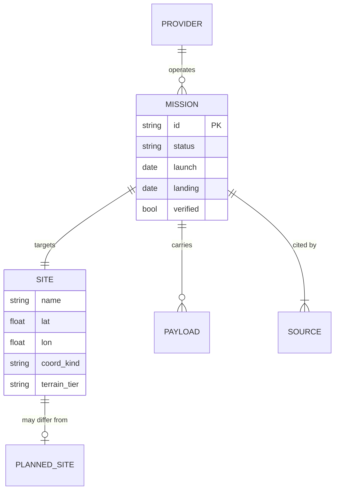
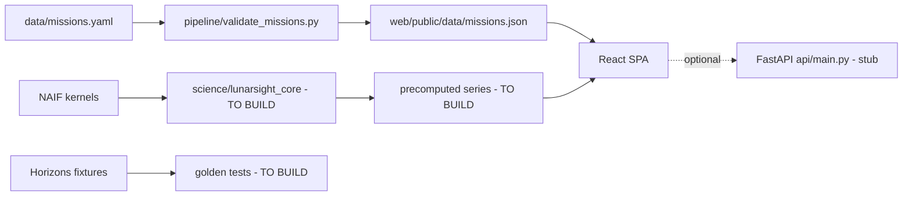
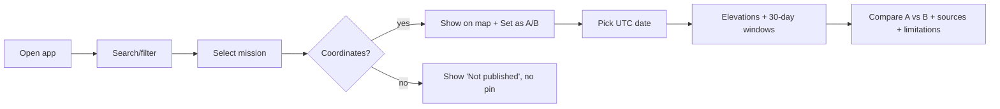

# CLPS Lunar Mission Browser — Team Playbook (AXON LunarSight)

> [!NOTE]
> **Historical Planning Artifact:** This document is an internal team playbook prepared during Phase 0–1 (2026-10-24). It is preserved for development provenance and challenge statement alignment history. For authoritative system documentation, refer to [README.md](README.md), [docs/METHODS.md](docs/METHODS.md), [docs/VALIDATION.md](docs/VALIDATION.md), and [DATA_README.md](DATA_README.md).

*Prepared 2026-10-24 from the uploaded files only. Evidence labels: **[REPO]** seen in the repo dump, **[FIX]** seen in the Horizons fixture files, **[DOC]** stated in the team PDFs, **[UNVERIFIED]** not checked against an authoritative source by me.*

---

## Table of Contents
- [0. Honesty box](#0-honesty-box-read-first)
- [0.1 Reconciliation with the official statement](#01-reconciliation-with-the-official-statement-added-2026-10-24)
- [1. Executive summary](#1-executive-summary)
- [2. Problem definition & product](#2-problem-definition--product)
- [3. Requirements traceability matrix](#3-requirements-traceability-matrix)
- [4. CLPS and lunar concepts](#4-clps-and-lunar-concepts-beginner-section)
- [5. Data sources](#5-data-sources)
- [6. Data schema](#6-data-schema)
- [7. Calculations](#7-calculations)
- [8. Architecture as it exists](#8-architecture-as-it-exists)
- [9. Code audit](#9-code-audit-static-inspection-only)
- [10. Gap analysis & recommended changes](#10-gap-analysis--recommended-changes)
- [11. MVP priorities](#11-mvp-priorities)
- [12. UI plan](#12-ui-plan)
- [13. Testing strategy](#13-testing-strategy)
- [14. Roadmap](#14-roadmap)
- [15. Risk register](#15-risk-register)
- [16. Demo & submission checklist](#16-demo--submission-checklist)
- [17. Glossary](#17-glossary)
- [18. References](#18-references-to-be-verified-when-read)

---

## 0. Honesty box (read first)

| Item | Status |
|---|---|
| Official 2026 challenge statement | **Body text supplied by you (2026-10-24 revision); I did not fetch it from the official site, and your message did not include the new title.** Part 3 is now based on that text. Still confirm the exact title, any "Expected outcomes/Resources" sections and judging notes on the official page. |
| Code execution | **Nothing was run.** All findings are static inspection. Line numbers are unavailable (the repo came as a flat dump); I cite file + symbol. |
| Mission facts (dates, coordinates, outcomes) | **Not independently verified.** The repo itself marks all records `verified: false`. |
| Architecture | Not re-compared. I document what the repo implements (React/Vite/Tailwind SPA + FastAPI + Python science package + precomputed JSON). |
| Team size | **Conflict:** Guidebook v2 says 4 members; Awards Playbook and Project Guide say 3. Decide and fix the docs. |

---

## 0.1 Reconciliation with the official statement (added 2026-10-24)

Official text (as supplied): *south-pole missions face extreme lighting and communication constraints; existing Sun/Earth-position tools have complicated interfaces; build an intuitive tool for planners, educators and the public to **compare landing sites and dates quickly**, visualizing **Sun and Earth positions relative to the horizon** to assess **power-generation potential** and **direct-to-Earth (DTE) communication windows**.*

| Topic | What the old playbook/Guidebook assumed | What the official text says | Change made |
|---|---|---|---|
| Framing | "CLPS Lunar Mission Browser": a catalog of CLPS missions | **No mention of CLPS or a mission catalog**. It is a *site/date comparison planning tool* | Mission Explorer demoted from mandatory to supporting. Core = site + date comparison |
| Region | All lunar sites, polar sites as one case | **South pole is the stated focus** | South-pole sites become the primary demo; near-side/far-side kept as contrast cases |
| Sites | Documented CLPS landing sites only | "Candidate" landing sites to evaluate | Need arbitrary lat/lon (click-anywhere) and preset candidate sites (Shackleton ridge, Malapert, Mons Mouton, Nobile; coordinates must be sourced) |
| Power | Illustrative/optional; Guidebook only counted hours above a threshold | **"Power generation potential" is explicit** | Power proxy is now required: Sun-up fraction, longest dark gap, optional vertical-array cosine factor, assumptions shown |
| Communications | Earth elevation windows | **"Direct-to-Earth windows" is explicit** | DTE window list with antenna clearance margin is required; labelled "geometric only" |
| Terrain | Stretch goal | "Extreme lighting" at the pole: a flat horizon is misleading there | Terrain horizon mask promoted from stretch to **P1, strongly recommended** for south-pole sites |
| UX | Nice to have | **"Intuitive… quickly"** is the point | Compare view in ≤3 clicks; efficiency is an acceptance criterion |
| Audience | planners, educators, public | same | No change |
| Dates | 30-day windows from a chosen date | "compare… dates" | Add multi-year date range and a "best windows" ranking (was optional) |

**Consequences for existing work:** `missions.yaml` is still useful as a source of real sites and as validation cases, but 5 of 8 records have null coordinates, so *candidate-site* data now matters more than mission metadata. The Horizons fixtures (IM-1 at 80.13°S is polar) remain relevant; add one at ~85°S.

---

## 1. Executive summary

1. **What are we building?** An intuitive planning tool to compare candidate lunar south-pole landing sites and dates by Sun and Earth position relative to the local horizon, giving power-generation potential and direct-to-Earth windows. A CLPS mission list is supporting context, not the product.
2. **What does the challenge require?** Per the supplied official text: quick comparison of sites and dates; visualization of Sun/Earth relative to the horizon; assessment of power potential and DTE windows; intuitive for planners, educators and public.
3. **Users:** mission planners, educators, the public.
4. **Minimum correct product:** site picker (presets + custom lat/lon) + date range + Sun/Earth horizon visualization + power-potential and DTE-window metrics + two-site comparison + visible limitations. Terrain horizon strongly recommended at the pole.
5. **Data needed:** a small hand-curated mission file (already exists, 8 records + 2 reference sites), NAIF SPICE kernels, Horizons fixtures for validation. No live mission API, no database, no ML, no orbital mechanics.
6. **Most reliable sources:** NASA CLPS pages and provider press kits (facts), NAIF SPICE (geometry), JPL Horizons (validation). Wikipedia is secondary only.
7. **Essential calculations:** coordinate validation, topocentric elevation/azimuth of Sun and Earth, rise/set window extraction, hours-above-threshold. Haversine distance is optional.
8. **Unnecessary:** orbital/trajectory mechanics, spacecraft tracking, ML, 3D Moon, scoring, real-time APIs.
9. **Biggest repo problems:** Phases 1–3 are essentially unbuilt (see §12). The science engine has only constants. `pip install -e science/` will likely fail. The theme toggle does not work. Data has null coordinates for 4 of 8 missions.
10. **Top-5 tasks:** (a) build `lunarsight_core` geometry + golden tests against the existing fixtures; (b) generate precomputed series JSON; (c) wire Explorer to `missions.json`; (d) get second-reviewer verification of mission records and resolve null coordinates; (e) Methods/limitations page + deploy.
11. **Risks:** frame/time errors (mitigated: fixtures exist), stale mission status (launch slips), schedule (the Guidebook rule check on pre-built work is unresolved).
12. **Stand-out without losing accuracy:** Horizons-validated geometry with a published validation table, flat-horizon honesty labels, and source/verified badges on everything.

---

## 2. Problem definition & product

**One sentence:** *A source-cited browser that lets anyone compare CLPS landing sites and dates by when the Sun and Earth are above the local horizon.*

**In scope (P0):** explorer, map, scenario picker, elevation numbers, timelines, comparison, methods/limitations.
**Out of scope:** link budgets, power predictions, flight planning, terrain-aware shadowing (stretch), 3D, scoring.

**MVP done when:** a first-time user finds IM-1, sets it as A, picks Blue Ghost 1 as B, picks a UTC date, and sees correct elevations, 30-day windows and a comparison with sources and limitations visible.

---

## 3. Requirements traceability matrix

Priority: **M** = mandatory (explicit), **I** = inferred, **R** = recommended, **O** = optional. Because the official text is unread, nothing is labelled "explicit NASA requirement" — "M" here means *explicit in team docs and must be re-confirmed on 28 Oct*.

| ID | Requirement | Source | Pri | Existing implementation | Action | Acceptance test |
|---|---|---|---|---|---|---|
| REQ-001 | Browse/search/filter missions and candidate sites (supporting context) | Guide §2; not in official text | R (was M) | `ExplorerPage.tsx` is a stub; data not loaded | Build after core | Typing "Intuitive" shows exactly IM-1, IM-2, IM-3 |
| REQ-002 | Mission records cite sources + verified flag | Guide, Blueprint §5.1 | M | Done in `missions.yaml`; all `verified:false` | Second-reviewer pass | 100% records `verified:true` or labelled unverified in UI |
| REQ-003 | Map of sites (include south-polar view) | Guide, official | I | None (Leaflet dep installed, unused) | Build | Marker for every record with non-null lat/lon; zero markers for null |
| REQ-004 | Never plot unknown coordinates | Prompt §4C | M | Schema allows null; UI missing | Enforce in UI | Griffin-1 listed but absent from map, shows "Not published" |
| REQ-005 | Sun elevation at site/time | Blueprint §4 | M | `constants.py` only | Build engine | Matches Horizons fixtures ≤0.05° (see §10.4) |
| REQ-006 | Earth elevation at site/time | same | M | none | Build | same; far-side never visible |
| REQ-007 | Date/time window comparison (multi-year range) | Official | M | none | Build timelines | Window list matches fixture sign changes ±1 h |
| REQ-008 | Side-by-side comparison | Guide | M | none | Build | Differences equal subtraction of displayed values |
| REQ-009 | Limitations always visible | Guide §3.1 | M | Stub text in `MethodsPage.tsx` | Add to every timeline | Text present on each view |
| REQ-010 | UTC, east-positive lon, units shown | `constants.py` | M | Methods table done | Keep | Table matches constants (add a test) |
| REQ-011 | Horizons validation proof | Blueprint §4.6 | R | 2 fixture pairs; no test code | Write tests | CI fails if diff > tolerance |
| REQ-012 | Accessibility (non-red/green, labels) | Blueprint §6.2 | R | Palette done (amber/cyan) | Chart text alternatives | axe clean |
| REQ-013 | Works if API is down | Blueprint §2 | R | Static JSON committed | Keep API optional | App works with API stopped |
| REQ-016 | Focus on south-pole candidate sites with sourced coordinates | Official text | M | Only IM-1, IM-2 (+2 reference sites) have coordinates | Add candidate presets with citations | ≥4 polar sites selectable, each with source |
| REQ-017 | Custom lat/lon site input | Official ("candidate") | I | API stub only | Build in static mode via precompute-on-demand or API | Any valid lat/lon returns a result; invalid rejected |
| REQ-018 | Power-generation potential metric | Official | M | None | Sun-up %, longest darkness, optional array model; assumptions visible | Values reproducible from the series |
| REQ-019 | DTE communication windows with margin | Official | M | None | Window list from Earth elevation vs horizon + margin | Matches fixture sign changes ±1 h |
| REQ-020 | Terrain-aware horizon at polar sites | Official ("extreme lighting") | I | None | LOLA mask, flat-vs-terrain toggle | Toggle changes polar result; labelled tier |
| REQ-021 | Intuitive and fast compare flow | Official | M | None | ≤3 clicks to a comparison; first-time user test | Unassisted user completes it in <2 min |
| REQ-014 | Deploy + README + demo | Guide | M | CORS localhost-only; no deploy workflow | Build | Live URL opens in incognito |
| REQ-015 | AI-use disclosure, licences, credits | Guidebook README | I | Not present | Add | README sections exist |

---

## 4. CLPS and lunar concepts (beginner section)

- **CLPS:** NASA buys delivery services; commercial providers (Astrobotic, Intuitive Machines, Firefly, Blue Origin, Draper/ispace-U.S., …) build and fly landers carrying NASA and other payloads. *App impact:* separate `provider`, `lander`, `mission` fields.
- **Soft landing vs impact vs orbit:** Peregrine never reached the Moon; IM-1 and IM-2 landed but tipped over; Blue Ghost 1 landed upright **[REPO]**. *Impact:* use `status` enum with `landed_partial` and `failed`; never infer success from a record existing.
- **Planned vs actual:** store `kind: planned|actual` on dates and coordinates. IM-2's repo record holds both the actual (Wikipedia, −84.7906/29.1957) and the intended site (−84.78/29.13) **[REPO]**.
- **Coordinates:** planetocentric lat, east-positive lon (−180..180), Moon radius 1737.4 km. Never use (0,0) for unknown.
- **Elevation:** angle above local horizontal; 0° horizon, 90° zenith, negative = below.
- **Tidal locking/libration:** Earth stays near a fixed spot in the sky at near-side sites, never visible from the far side, and flickers at the limb. **[FIX]** Blue Ghost 1 (18.56°N, 61.81°E) sees Earth at 21–30° all month; IM-1 (80°S) sees it at 3–16°.
- **Why the pole is the headline case (official text):** low Sun angles and Earth hovering near the horizon mean terrain and mast height can decide power and DTE. Treat flat-horizon polar results as indicative only.
- **Polar lighting:** the spin axis is ~1.5° from the ecliptic normal, so the Sun hugs the horizon at the poles. **[FIX]** IM-1's Sun peaks near 11° in Feb–Mar 2024 and goes below 0° around 3 Mar. A flat horizon is therefore especially unreliable at the pole; terrain decides.
- **Honest caveats:** Earth above horizon ≠ a communication link; Sun above idealized horizon ≠ illumination.

---

## 5. Data sources

| Source | Owner | URL | Use | Status |
|---|---|---|---|---|
| CLPS program/provider/landing-site pages | NASA | nasa.gov/commercial-lunar-payload-services/ | mission facts | Essential; **not fetched by me** |
| LROC featured sites | NASA/GSFC/ASU | lroc.im-ldi.com | landing coordinates | Essential for actual positions |
| NAIF generic kernels | NASA JPL | naif.jpl.nasa.gov/pub/naif/generic_kernels/ | geometry | Essential. Kernel hashes pinned in `kernels.lock` **[REPO]**; filenames not re-verified by me |
| JPL Horizons API | JPL | ssd-api.jpl.nasa.gov/doc/horizons.html | validation | Essential for tests; keyless |
| LOLA south-pole DEM / SVS Moon Kit | NASA | imbrium.mit.edu, svs.gsfc.nasa.gov/4720 | terrain horizon mask | **Recommended (was optional)**; file sizes not verified |
| Wikipedia | — | — | secondary cross-check | Never sole source |

**Decisions:** static curated YAML→JSON is sufficient (no DB, no live mission API; NASA has no known complete CLPS JSON API — **[UNVERIFIED]**). Precomputed series are preferable to live computation. Fallback if Horizons is down: committed fixtures.

---

## 6. Data schema

Existing schema (`data/schema/missions.schema.json`) is good. Gaps and fixes:

| # | Issue | Fix |
|---|---|---|
| S1 | `planned_site` exists in YAML/JSON but not in schema or `types/mission.ts` | Add to both |
| S2 | `needs-check-farside-and-schrodinger` bundles two missions in one record | Split into two records once verified |
| S3 | No `last_verified` or `original_value` per field | Add `verified_by`, `verified_on` |
| S4 | `coord_kind: planned_region_center` used for Blue Ghost's *actual* mission | Keep but display as "approximate (region centre)" |
| S5 | No `additionalProperties:false` | Add so typos fail CI |
| S6 | No schema rule linking null coords ↔ `unknown` | Add `if lat is null then coord_kind = unknown` |



Example (from repo, unverified): IM-1 → `lat -80.13, lon 1.44, coord_kind actual, elevation_m 2579, status landed_partial, verified false`.
**Rules:** null = unknown; never convert "2026-11 (month, planned)" into a day; show unresolved conflicts rather than picking one.

---

## 7. Calculations

| Calculation | Pri | Where |
|---|---|---|
| Lat/lon range validation | P0 | `lunarsight_core` + API |
| Topocentric elevation (and azimuth) of Sun/Earth | P0 | `lunarsight_core` (to build) |
| Window extraction (runs ≥ threshold) | P0 | Python precompute or TS |
| Hours above threshold, both-up hours | P0 | compare view |
| Date handling (UTC, precision-aware) | P0 | UI |
| Haversine site-to-site distance | Optional | UI |
| Power proxy: Sun-up fraction, longest dark gap, optional $P=S A\eta\max(0,\cos i)f_\odot$ (assumptions shown, not a mission prediction) | P0 | engine |
| DTE window = Earth elevation > horizon + margin | P0 | engine |
| Terrain horizon mask (ray-cast over LOLA DEM, curvature-corrected) | P1 | `pipeline/` |
| Orbital mechanics / ML | **Not needed** | — |

### 7.1 Elevation (core)
Site vector in the Moon body-fixed frame `MOON_ME`:

$$\vec s = R\,(\cos\phi\cos\lambda,\ \cos\phi\sin\lambda,\ \sin\phi),\quad \hat u=\vec s/|\vec s|$$

$$\vec v=\vec r_{body}-\vec s,\qquad \theta=\arcsin\!\big(\hat v\cdot\hat u\big)$$

with $R=1737.4$ km and $\vec r_{body}$ from SPICE `spkpos(body, et, "MOON_ME", "LT+S", "MOON")`. Sun "up" = upper limb: $\theta + 0.267^\circ > 0$ (the repo's `SUN_ANGULAR_RADIUS_DEG`; true value computed as 0.2665°).

**Evidence the convention matches Horizons [FIX]:** the headers state `Center pole/equ: MEAN_ME`, radii 1737.4, `AIRLESS`, `Alt 0`. Horizons marks '*' when the *upper limb* is up. In the IM-1 Sun fixture, centre elevation −0.245° is still flagged '*' (2024-Mar-03 10:00) and −0.333° is not; on 17 Mar, −0.227° is '*' and −0.313° is not. That brackets the threshold between ~−0.25° and ~−0.31°, consistent with −0.267°.

Notes: Horizons "apparent" includes gravitational light-bending; SPICE `LT+S` does not — expect ≪0.05° differences, but document it.

### 7.2 Haversine (optional)
$$a=\sin^2\tfrac{\Delta\phi}{2}+\cos\phi_1\cos\phi_2\sin^2\tfrac{\Delta\lambda}{2},\quad d=2R\arcsin\sqrt a$$

```python
import math
R_MOON_KM = 1737.4
def moon_distance_km(lat1, lon1, lat2, lon2):
    p1, l1, p2, l2 = map(math.radians, (lat1, lon1, lat2, lon2))
    a = math.sin((p2-p1)/2)**2 + math.cos(p1)*math.cos(p2)*math.sin((l2-l1)/2)**2
    return 2*R_MOON_KM*math.asin(math.sqrt(a))
```
**Executed check:** IM-1 (−80.13, 1.44) → IM-2 (−84.7906, 29.1957) = **175.5 km**. Quarter-equator (0,0)→(0,90) = 2729.10 km = (π/2)R ✔. Never use Earth's radius. Recommended: omit unless a comparison row needs it.

### 7.3 Time
Input/display UTC; SPICE `str2et` handles leap seconds. Treat "2026-11" as a month window, not a countdown. Do not show a countdown for dates with precision coarser than day.

### 7.4 Window extraction
Sample hourly, find runs where `elev ≥ threshold`; optional bisection to ~1 min. Test on the fixtures: Blue Ghost Sun crosses 0° between 2025-03-02 00:00 and 01:00 and between 03-16 20:00 and 21:00 (≈14.8 days up), matching "about 14 days of operations" in the mission notes **[REPO/FIX]**.

---

## 8. Architecture as it exists



| Component | Status |
|---|---|
| `validate_missions.py` | Implemented (writes to two paths) |
| `fetch_kernels.py`, `fetch_horizons_fixtures.py`, `fetch_terrain.py` | Implemented; authors say not network-tested; fixtures prove the Horizons script ran |
| `lunarsight_core/constants.py` + `test_constants.py` | Implemented |
| Geometry engine, `build_geometry.py` | **Missing** |
| `api/main.py` | Stub: `/api/health`, `/api/provenance` only |
| Web: Layout, theme store, Methods table | Implemented |
| Web: Explorer, Map, Timelines, Compare | **Missing** (Explorer is a placeholder) |

---

## 9. Code audit (static inspection only)

| ID | File / symbol | Sev | Problem | Fix |
|---|---|---|---|---|
| C-01 | `science/pyproject.toml` | High | `readme = "README.md"` but no `science/README.md` in the tree → `pip install -e science/` (README step 1) likely errors | Add file or drop the key |
| C-02 | `web/src/pages/ExplorerPage.tsx`, `stores/missionStore.ts` | High | Store never populated; no fetch of `missions.json`; no map/timeline/compare code. Phases 1–3 unbuilt | Build (§14) |
| C-03 | `science/lunarsight_core/` | High | No geometry module; Horizons fixtures have no test consuming them (`inspect_fixtures.py` only prints headers) | Implement + golden tests |
| C-04 | `Layout.tsx` / `index.html` / `index.css` | Medium | `<html class="dark">` is static and `Layout` hardcodes `bg-space-900 text-space-100`; toggling `themeStore` only changes the inner wrapper, so light mode is broken and body variables never change | Toggle `document.documentElement` class and use theme tokens, or remove the toggle |
| C-05 | `api/main.py` | Medium | CORS allows only `localhost:5173`; deployed site would be blocked | Env-driven origins |
| C-06 | `data/missions.yaml` | High | Lat/lon null for Griffin-1, Endurance, IM-3, far-side, Peregrine (5/8) → only 3 map markers today | Research coordinates or accept "Not published" |
| C-07 | `types/mission.ts` | Medium | `lat/lon: number\|null` is right, but the Guidebook's `map.ts`/`explorer.ts` call `m.lat.toFixed()` on a non-null type; copying that code would crash on null | Null-guard when porting |
| C-08 | `web/tsconfig.node.json` + `tsc -b` | Low-Med | `composite:true` without `noEmit`/declaration settings may emit `vite.config.js` or error under `tsc -b` | Verify with `npm run build`; **not run** |
| C-09 | `package.json` `@types/node ^26.6.5` | Low | Unusual version; verify installs | Pin to Node 20/22 types |
| C-10 | `index.html` | Low | References `/favicon.svg`, absent | Add file |
| C-11 | `index.css` | Low | `.light .glass-card` never matches (no `.light` class) | Remove |
| C-12 | `validate_missions.py` | Low | `generated_at` changes every run → noisy diffs; duplicate legacy output `web_public_data/` can drift | Drop legacy copy |
| C-13 | `BUILD_LOG.md` D-005 | Low | Claims `setuptools-scm`; `pyproject.toml` doesn't use it | Correct the log |
| C-14 | `constants.py` header | Low | Mentions `Methods.tsx`; file is `MethodsPage.tsx` | Fix comment |
| C-15 | Fixture coverage | Medium | Only IM-1 (Feb–Mar 2024) and Blue Ghost 1 (Mar 2025) fixtures; Blueprint asks for 5–10 sites | Add IM-2, a far-side/limb case, Apollo 11 |
| C-16 | Docs | Medium | Guidebook says kernel `moon_de440_220930.tf`; repo/README/`kernels.lock` say `250416` | Use repo version; confirm on NAIF |
| C-17 | Guidebook `validate_apollo.py` | Medium | ALSJ numbers (Sun ≈10.65°, Earth ≈59.4°) are asserted from memory in the guide; the guide itself says to confirm | Read ALSJ table, record the values |
| C-18 | `tests/` | Info | `needs_kernels` marker pattern is good; no CI workflow exists in repo | Add `.github/workflows` |

**Tests/builds run: none.**

### Data-level observations
- Blue Ghost 1 uses the LROC region centre (18.56, 61.81), while LROC reports touchdown near 19°N, 62°E **[REPO]** → keep "approximate".
- IM-2 actual coordinate is Wikipedia-only (secondary) **[REPO]**.
- Statuses/dates for Griffin-1 (NET Nov 2026), Endurance (2027) and IM-3 are fast-moving; re-verify within 48 h of submission.
- Fixtures use altitude 0 on a 1737.4 km sphere; IM-1's 2579 m elevation is ignored — fine for flat-horizon mode, relevant only for terrain mode.

---

## 10. Gap analysis & recommended changes

| Gap | Req | Fix | Test |
|---|---|---|---|
| No geometry engine | 005/006 | `lunarsight_core/geometry.py`: load kernels, `elevation(body, lat, lon, et)` | Golden test vs fixtures |
| No precompute step | 005–008 | `pipeline/build_geometry.py` → `web/public/data/timeseries/*.json` (gitignored per README, so decide: commit a small hourly file, as the Guidebook suggests, for static hosting) | Row count = hours; spot checks |
| Explorer/map/compare | 001–008 | React components (§12) | e2e |
| Verification | 002 | second reviewer per record | 100% flagged |
| Deployment | 014 | GH Actions Pages workflow; set `base` in `vite.config.ts` | Incognito load |

### 10.4 Golden-test spec (use existing fixtures)
Parse each fixture row `Date, solar-flag, interferer-flag, Az, El`. Run engine at identical UTC times. Tolerance start: **0.05° elevation, 0.1° azimuth** (azimuth is ill-conditioned near zenith — skip |El|>85°). Also assert: solar '*' flag ⇔ `el + 0.267 > 0` (disagreements allowed only within ±0.01° of the threshold). Mark synthetic tests as synthetic.

---

## 11. MVP priorities

**P0:** site presets + custom lat/lon, date range, Sun/Earth horizon visualization, power metrics, DTE windows, comparison, limitations. **P1:** terrain horizon mask with flat/terrain toggle, "Sun AND Earth both up" ranking, mission explorer; shareable URL state; CSV export; Horizons "verify" button via API. **P2:** mast-height slider, 3D Moon, any single score. **Avoid:** live tracking, ML, orbit propagation, unsourced "best site" rankings.

---

## 12. UI plan

Pages (revised order): Compare (A/B sites + date range; landing screen), Map/site picker with south-polar view, Methods; Mission Explorer is secondary. Hierarchy: `Layout > ExplorerPage > {MissionFilters, MissionCard[], MoonMap}`, `ComparePage > {ScenarioPanel×2, ElevationGauge, TimelineBar, ComparisonTable}`.



Map: a flat equirectangular image is fine for global view, but the south pole is heavily distorted (Blueprint §6.2 suggests a polar stereographic view for P1). Colours: amber Sun, cyan Earth (already in `tailwind.config.js`). Every timeline shows "Idealized horizon, not terrain-aware" and "Geometric only — not a link budget" (strings already in `constants.py`).

---

## 13. Testing strategy

- **Unit:** schema validation, null coordinate handling, status enum, date precision, haversine (§7.2 values), window extraction on synthetic arrays.
- **Scientific:** fixtures (§10.4); sanity: max Sun elevation ≈ 90° − |lat| ± 1.5° **[FIX: IM-1 ≈ 10.95° ✔ vs 9.9–11.4° expected; Blue Ghost 71.2° vs ≤73°]**; Earth never above horizon for far-side longitudes; Sun cycle ≈ 29.5 d.
- **E2E:** search "Intuitive"; Set A/B; change date; null-coordinate mission has no pin.
- **Failure:** missing JSON file shows banner; date outside precompute range shows message; API down still works.
- **Accessibility:** axe, keyboard, colour-blind check.

---

## 14. Roadmap

| Phase | Tasks | Done when |
|---|---|---|
| 1 (now) | Fix C-01, C-04, C-05; decide team size & rule on pre-built work | `pip install -e science/` and `npm run build` succeed |
| 2 | Geometry engine + golden tests on both fixtures | CI green |
| 3 | `build_geometry.py` precompute; commit data | JSON loads |
| 4 | Explorer + Map + loading/empty/error states | REQ-001/003/004 pass |
| 5 | Scenarios, timelines, compare | REQ-005–008 pass |
| 6 | Methods + validation table; second-reviewer verification | REQ-002/009/011 |
| 7 | Deploy; re-check official page for title/judging notes; feature freeze; demo | REQ-014 |

**First five actions:** (1) fix `pyproject` readme; (2) write `geometry.py` + fixture test; (3) add sourced south-pole candidate sites and power/DTE metrics to the engine spec; (4) populate `missionStore` from `missions.json`; (5) schedule verification of every record.

**Ownership (flexible):** data/science (YAML, kernels, tests), frontend (explorer/compare), visualization (map/timelines), integration (CI, deploy, README). Shared contracts: `missions.schema.json`, `types/mission.ts`, and the timeseries JSON shape — agree before parallel work. Branch per person, PR with build + tests passing.

---

## 15. Risk register

| Risk | P | I | Early warning | Mitigation / fallback |
|---|---|---|---|---|
| Frame/time error → plausible but wrong angles | M | H | Fixture diffs > 0.05° | Golden tests in CI; try `IAU_MOON` only as documented fallback |
| Official challenge differs from assumptions | M | H | 28 Oct text | Re-run §3 |
| Mission status/date stale | H | M | News of slip | Re-verify 48 h before submission; show `accessed` date |
| Missing coordinates | H | M | Null count | "Not published" labels |
| Pre-built work disallowed by rules | Unknown | H | Terms of use unread | Read terms and ask organizers now |
| Terrain work delays core | H | H | Phase 4 slipping | Ship flat horizon with strong caveat first | Present as limitation |
| Scope creep | H | M | New feature ideas after freeze | P2 only after P0 passes |
| NAIF filename change | L | M | Download 404 | `kernels.lock` + manual download |
| Deployment surprise | M | M | CORS/base-path errors | Early test deploy |

---

## 16. Demo & submission checklist

- [ ] Official 2026 statement read; §3 updated
- [ ] Rules/deadline checked on spaceappschallenge.org (team docs say 15 Nov 11:59 pm local — **confirm**; demo length limit also unconfirmed)
- [ ] Every record verified or labelled unverified
- [ ] Validation table shown (fixture diffs)
- [ ] Limitations visible; null coordinates never plotted
- [ ] Live URL works in incognito; README, licences, image credits (LROC/NASA) and AI-use disclosure present
- [ ] Demo rehearsed twice with fallback recording

---

## 17. Glossary

**CLPS** Commercial Lunar Payload Services · **Elevation** angle above horizon · **Idealized horizon** flat plane at the site · **Libration** apparent wobble of the Moon · **MOON_ME** mean-Earth/polar-axis lunar frame · **SPICE/kernel** NASA geometry toolkit/data file · **Horizons** JPL ephemeris service · **PSR** permanently shadowed region · **Upper limb** top edge of the Sun's disk.

## 18. References (to be verified when read)

NASA CLPS: https://www.nasa.gov/commercial-lunar-payload-services/ · NAIF: https://naif.jpl.nasa.gov/naif/ · Horizons API: https://ssd-api.jpl.nasa.gov/doc/horizons.html · Space Apps 2026: https://www.spaceappschallenge.org/2026/ · Terms: https://www.spaceappschallenge.org/legal/ · ALSJ Sun/Earth table: https://www.nasa.gov/history/alsj/alsj-EarthSun_AltAz.html · LOLA polar DEMs: https://imbrium.mit.edu/BROWSE/LOLA_GDR/POLAR/SOUTH_POLE/ · LROC: https://lroc.im-ldi.com/
