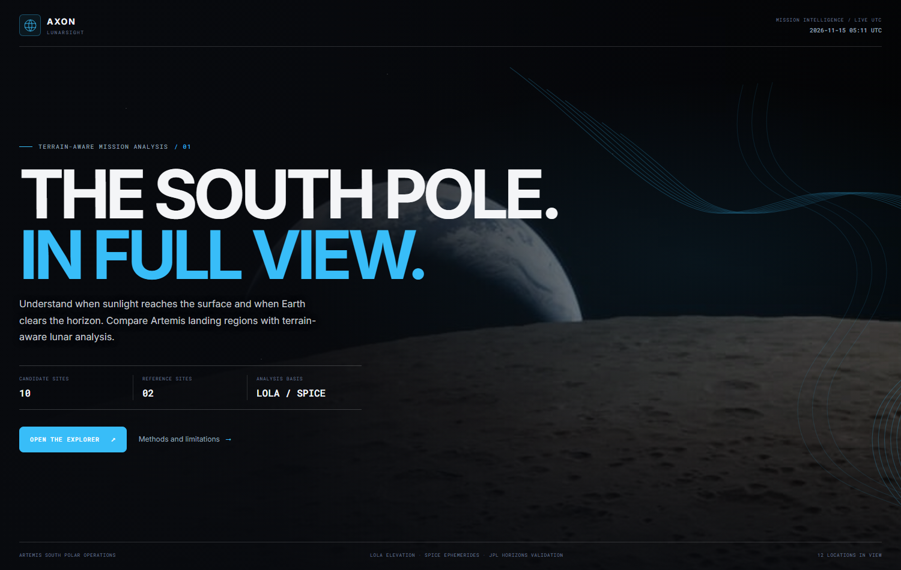
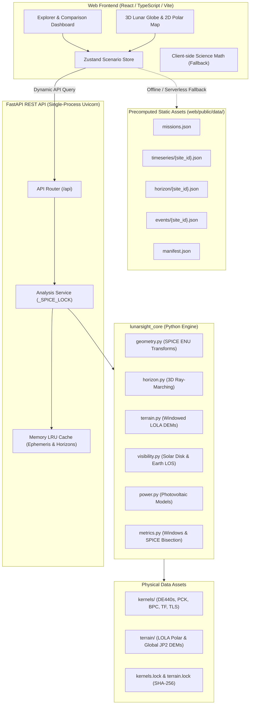
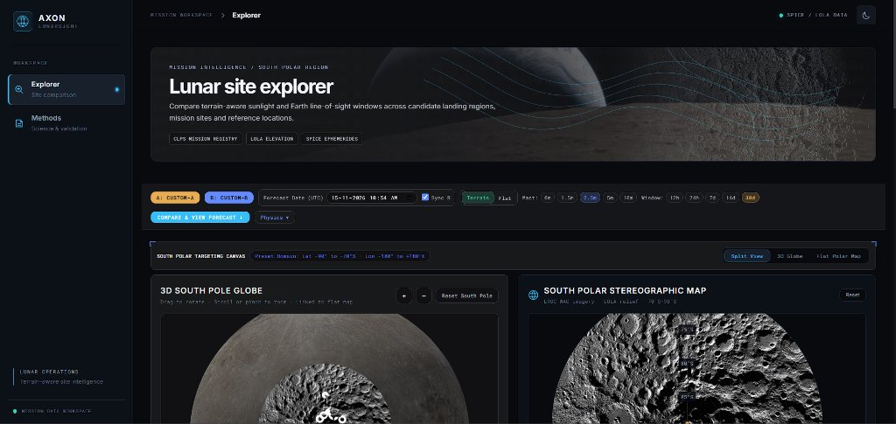
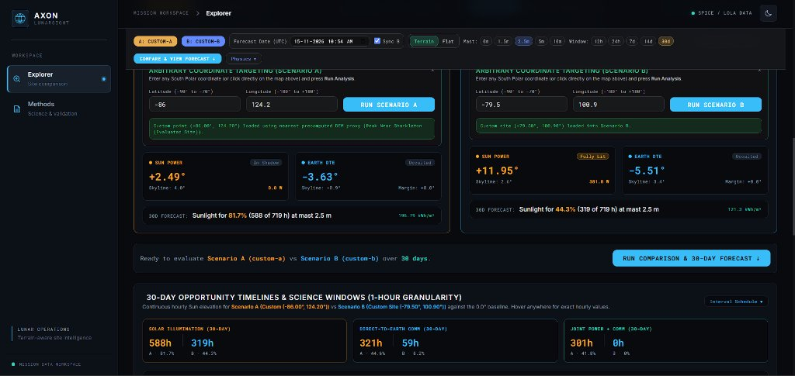
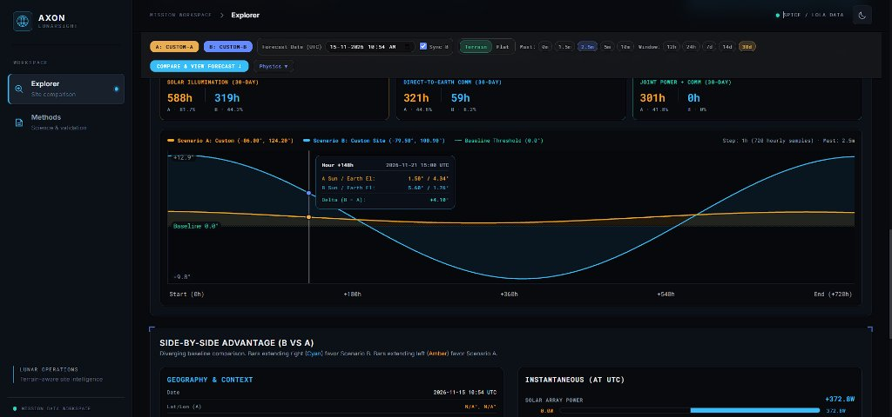
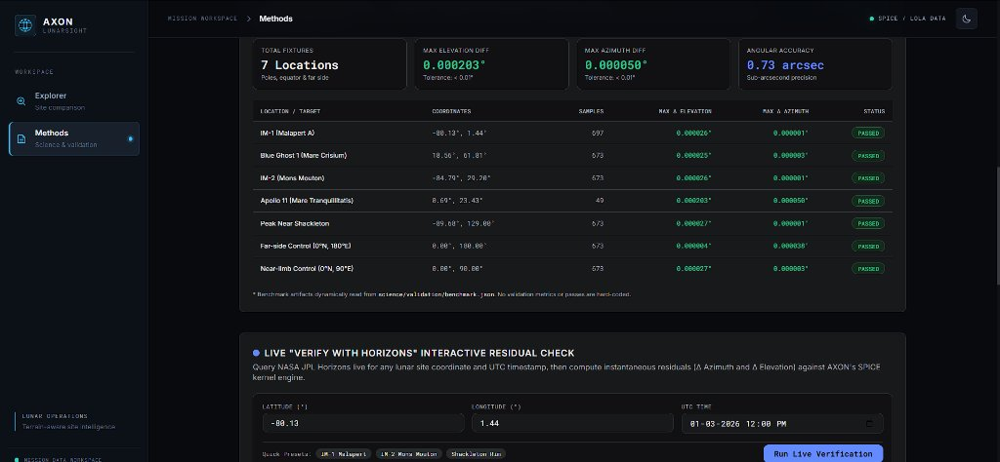

# AXON LunarSight

**[Lunar Landing Site Navigator](https://www.spaceappschallenge.org/) — 2026 NASA Space Apps Challenge**
*Subjects: Human Exploration · Moon · Software · Space Exploration | Difficulty: Advanced / Intermediate*

> *Real sources. Clear calculations. Useful comparisons.*


An intuitive scientific modeling engine and interactive dashboard designed for mission planners, aerospace engineers, educators, and the public to evaluate and compare candidate lunar landing sites and dates. AXON LunarSight calculates high-precision topocentric Sun and Earth positions using NASA NAIF SPICE kernels and traces lines-of-sight against 3D ray-marched terrain horizons derived from Lunar Orbiter Laser Altimeter (LOLA) Digital Elevation Models (DEMs). The application models solar disk fraction illumination, photovoltaic power potential across multiple array architectures, and Direct-to-Earth (DTE) communication visibility under lunar libration.

---

## ⚡ Quick Start

| Want to... | Go here |
|---|---|
| **Run locally (5 min)** | [§21 Backend Setup](#21-backend-setup--virtual-environment) → [§22 Frontend](#22-frontend-setup--build) |
| **Download terrain data** | [Kaggle Dataset](#24-required-datasets--lockfiles) (`devansen/terrain-moon`) |
| **Read the science** | [§11 Ray-Marching](#11-3d-ray-marching-horizon-methodology) → [§12 Solar Model](#12-solar-illumination--disk-fraction-formulation) |
| **See the site data** | [§3 Key Sites Table](#3-key-polar-landing-sites-summary-table) |
| **Verify ground truth** | [§27 Validation & 112 Tests](#27-verification-validation--automated-tests-112-tests) |
| **Explore the API** | [§26 REST Endpoints](#26-rest-api-endpoints-reference) |
| **Deploy with Docker** | [§30 CI/CD Pipeline](#30-deployment--cicd-pipeline) |

---

## Table of Contents
- [1. Project Overview & Problem Statement](#1-project-overview--problem-statement)
- [2. Scientific Scope: Topocentric Geometry vs Engineering Link Budgets](#2-scientific-scope-topocentric-geometry-vs-engineering-link-budgets)
- [3. Key Polar Landing Sites Summary Table](#3-key-polar-landing-sites-summary-table)
- [4. Main Features](#4-main-features)
- [5. Technology Stack](#5-technology-stack)
- [6. System Architecture](#6-system-architecture)
- [7. Frontend Architecture](#7-frontend-architecture)
- [8. Backend & API Architecture](#8-backend--api-architecture)
- [9. Scientific Computation Engine (`lunarsight_core`)](#9-scientific-computation-engine-lunarsight_core)
- [10. Lunar Terrain & LOLA DEM Integration](#10-lunar-terrain--lola-dem-integration)
- [11. 3D Ray-Marching Horizon Methodology](#11-3d-ray-marching-horizon-methodology)
- [12. Solar Illumination & Disk Fraction Formulation](#12-solar-illumination--disk-fraction-formulation)
- [13. Solar Power Generation Potential Models](#13-solar-power-generation-potential-models)
- [14. Earth Visibility & Communication Windows](#14-earth-visibility--communication-windows)
- [15. Landing-Site Evaluation & Custom Coordinates](#15-landing-site-evaluation--custom-coordinates)
- [16. Mission Planning & Multi-Site Comparison](#16-mission-planning--multi-site-comparison)
- [17. SPICE Kernels & Ephemeris Dependencies](#17-spice-kernels--ephemeris-dependencies)
- [18. Sourced Datasets & Scientific Bibliography](#18-sourced-datasets--scientific-bibliography)
- [19. Repository Directory Map](#19-repository-directory-map)
- [20. Installation Prerequisites](#20-installation-prerequisites)
- [21. Backend Setup & Virtual Environment](#21-backend-setup--virtual-environment)
- [22. Frontend Setup & Build](#22-frontend-setup--build)
- [23. Environment Variables & Configuration](#23-environment-variables--configuration)
- [24. Required Datasets & Lockfiles](#24-required-datasets--lockfiles)
- [25. Running the Complete Application](#25-running-the-complete-application)
- [26. REST API Endpoints Reference](#26-rest-api-endpoints-reference)
- [27. Verification, Validation & Automated Tests (112 Tests)](#27-verification-validation--automated-tests-112-tests)
- [28. Performance Benchmarks & Caching Architecture](#28-performance-benchmarks--caching-architecture)
- [29. Troubleshooting Guide](#29-troubleshooting-guide)
- [30. Deployment & CI/CD Pipeline](#30-deployment--cicd-pipeline)
- [31. Planned Enhancements & Roadmap](#31-planned-enhancements--roadmap)
- [32. License & Acknowledgements](#32-license--acknowledgements)

---

## 1. Project Overview & Problem Statement


*Figure 1: AXON LunarSight Mission Overview Dashboard — Featuring the mission intelligence landing page with live UTC telemetry (2026-11-15 10:54 UTC), candidate landing site registry (10 candidate sites, 2 reference sites), and direct access to the Lunar Site Explorer and Scientific Methods documentation.*

Missions to the Moon's South Pole—such as NASA's Commercial Lunar Payload Services (CLPS) landers and Artemis crewed missions—face extreme lighting and communication environments. Because the Moon's spin axis has an obliquity of only 1.54° relative to the ecliptic pole, the Sun perpetually skims low along the horizon, casting multi-kilometer shadows across deep impact basins while elevated crater rims and ridge massifs receive extended periods of illumination. Similarly, the Earth remains low in the lunar sky, oscillating over a ~27.3-day libration cycle that periodically occults direct line-of-sight behind local topography.

Traditional trajectory and mission planning tools present steep learning curves, require specialized software installations, or model the Moon as an idealized flat sphere. AXON LunarSight addresses this gap by providing:
1. **Rapid Site & Date Trade-Offs:** Direct side-by-side evaluations between candidate landing sites (Scenario A vs Scenario B) across arbitrary UTC epochs between 2024 and 2028.
2. **Terrain-Aware Topographic Horizons:** 3D ray-marching through high-resolution Lunar Reconnaissance Orbiter (LRO) LOLA DEMs, ensuring horizon skylines accurately capture physical terrain obstructions.
3. **Solar Power Generation Potential:** Accurate topocentric solar disk fraction modeling ($f_{\text{sun}} \in [0, 1]$) with array architecture trade-offs (horizontal flat, vertical mast, 2-axis tracking).
4. **Direct-to-Earth (DTE) Communication Windows:** Geometric line-of-sight analysis incorporating customizable RF antenna elevation clearance margins.
5. **Interactive Opportunity Visualizer:** A 30-day timeline visualizer (720 hourly segments) computing contiguous illuminated windows and dark survival gap durations.
6. **Dual Execution Architecture:** Seamless operation either as an offline, serverless static application powered by precomputed JSON assets or as a dynamic real-time system backed by a FastAPI/SPICE computation server.

### Visual Architecture & Landing Page Scope
The mission overview dashboard (*Figure 1*) serves as the primary operational entry point:
- **Live Ephemeris & Data Telemetry:** Tracks real-time UTC ephemeris time (`2026-11-15 10:54 UTC`) and displays verified system status (`• SPICE / LOLA DATA`) indicating that both NAIF planetary ephemerides and LOLA DEM rasters are fully initialized.
- **Curated Site Registry:** Surfaces 10 prime candidate landing regions spanning high-priority Artemis III exploration zones (Connecting Ridge, Shackleton Rim, Faustini, Haworth, Nobile, Malapert Massif) alongside 2 reference baseline sites (Apollo 11 in Mare Tranquillitatis and Blue Ghost 1 in Mare Crisium).
- **Dual Mission Pathways:** Provides immediate routing to either the dual-scenario **Lunar Site Explorer** (`OPEN THE EXPLORER ↗`) or the fully transparent **Science Methods & Validation** documentation (`Methods and limitations →`).

### NASA Space Apps Challenge Alignment

AXON LunarSight was built for the **"Lunar Landing Site Navigator"** challenge prompt at the **2026 NASA Space Apps Challenge** (Subjects: Human Exploration · Moon · Software · Space Exploration | Difficulty: Advanced / Intermediate). The challenge calls for an intuitive tool that lets mission planners, educators, and the public compare landing sites and dates quickly — visualizing Sun and Earth positions relative to the terrain horizon to assess power generation potential and Direct-to-Earth communication windows.

AXON addresses every dimension of this challenge:
- **Intuitive comparison:** Dual-scenario A vs B explorer with synchronized UTC epochs and instant metric cards (solar hours, comm hours, joint windows).
- **Sun/Earth relative to terrain:** 3D ray-marched LOLA DEM horizons with topocentric SPICE geometry — not a flat-sphere approximation.
- **Power generation potential:** Solar disk fraction ($f_\text{sun}$) with 4 solar array architecture models and instantaneous watt readouts per scenario.
- **DTE communication windows:** Terrain-aware geometric line-of-sight to Earth's center of mass with customizable antenna mast-height clearance buffers.
- **Accessible to all audiences:** Serverless static mode runs with zero backend for public and educational use; full dynamic mode available for mission planners.

---

## 2. Scientific Scope: Topocentric Geometry vs Engineering Link Budgets

> [!IMPORTANT]
> **AXON LunarSight models deterministic topocentric line-of-sight geometry and clear-sky solar irradiance, NOT an empirical electrical power system or RF telecommunications link-budget simulation.**

- **Solar Visibility ≠ Delivered Electrical Power:** A site is counted as illuminated when the Sun's upper limb ($\text{elevation}_{\text{center}} + 0.267^\circ$) rises above the local terrain skyline ($f_{\text{sun}} > 0$). In flight operations, delivered kilowatt-hours depend on photovoltaic cell conversion efficiency ($\eta$), solar incidence angle ($\cos i$), thermal bandgap derating during lunar midday, battery round-trip storage efficiency, and regolith dust contamination from descent engine plumes.
- **Earth Line-of-Sight ≠ Telecommunications Link Margin:** Direct-to-Earth visibility indicates an unobstructed geometric vector from the lunar surface to Earth's center of mass. Actual radio communications depend on antenna gain patterns, transmitter EIRP, free-space path loss (~210 dB at X/Ka-band), ground station receiver sensitivity (e.g. NASA DSN 34m/70m dishes), and lunar surface multipath reflections.
- **The "Flat Sphere, 0 Deg Horizon" Baseline:** The baseline comparison models the Moon as an idealized, uniform sphere ($R = 1,737.4\text{ km}$, $\text{elevation} = 0\text{ m}$) with an unoccluded 0.0° tangent horizon. It is **not** an equivalent horizon at the site's elevation: high mountain summits (such as Connecting Ridge at +1,653 m) look downward over surrounding lowlands, depressing the local horizon dip angle below 0° (down to -3.37°), which enables peaks to capture solar illumination even when the Sun dips below the flat sphere datum.

---

## 3. Key Polar Landing Sites Summary Table

Evaluated across the full 5-year multi-lunation baseline (43,848 hourly ephemerides from **2024-01-01 to 2028-12-31 UTC**) with an observer mast height of $h = 1.5\text{ m}$ and threshold $\tau = 0.0^\circ$:

| Landing Site | Latitude, Longitude | Bound LOLA DEM | Surface Elevation | Flat Sphere 0° Sun % | Terrain Sun % | Max Dark Gap (h) | Terrain DTE % | Site Type |
|---|---|---|---|---|---|---|---|---|
| **Connecting Ridge (Evaluated Site)** | -89.534°, -150.052° | `LDEM_875S_20M` (20 m/px) | +1,653.0 m | 53.4% | **58.3%** | 321.0 h | 48.9% | Specific evaluated site |
| **Connecting Ridge (Centroid)** | -89.450°, -136.000° | `LDEM_875S_20M` (20 m/px) | +1,931.3 m | 53.3% | **55.9%** | 338.0 h | 47.7% | Region center |
| **Shackleton Ridge (Evaluated Site)** | -89.017°, 126.273° | `LDEM_85S_20M` (20 m/px) | +1,167.2 m | 55.2% | **35.2%** | 1,489.0 h | 52.8% | Specific evaluated site |
| **Shackleton Rim (Centroid)** | -89.680°, 129.000° | `LDEM_85S_20M` (20 m/px) | -2,784.9 m | 52.8% | **0.0%** | 43,848.0 h | 0.0% | Region center (crater floor) |
| **Malapert Massif (Region Centre)** | -85.990°, -2.930° | `LDEM_80S_20M` (20 m/px) | +4,841.0 m | 49.3% | **46.8%** | 438.0 h | **0.0%** | Region center (crest reaches 100%) |
| **Mons Mouton Summit** | -84.600°, 31.000° | `LDEM_80S_20M` (20 m/px) | +5,044.6 m | 47.7% | **44.9%** | 498.0 h | 48.6% | Reference point |
| **IM-2 (Mons Mouton / PRIME-1)** | -84.791°, 29.196° | `LDEM_80S_20M` (20 m/px) | +5,322.5 m | 47.9% | **43.1%** | 512.0 h | 48.7% | Specific mission site |
| **IM-1 (Malapert A)** | -80.130°, 1.440° | `LDEM_75S_30M` (30 m/px) | +2,598.9 m | 46.8% | **41.2%** | 560.0 h | 47.6% | Actual landed site |
| **Nobile Rim 1 (Candidate)** | -85.350°, 36.500° | `LDEM_80S_20M` (20 m/px) | +6,350.4 m | 48.5% | **45.0%** | 478.0 h | 48.8% | Candidate region |
| **Faustini Rim A (Candidate)** | -87.880°, 90.000° | `LDEM_85S_20M` (20 m/px) | +62.5 m | 50.8% | **46.1%** | 462.0 h | 49.0% | Candidate region |
| **Haworth Rim (Candidate)** | -86.750°, -22.840° | `LDEM_85S_20M` (20 m/px) | +1,630.4 m | 49.9% | **43.7%** | 495.0 h | 48.9% | Candidate region |
| **Blue Ghost 1 (Mare Crisium)** | +18.560°, +61.810° | `LDEM_64` (~474 m/px) | -3,651.3 m | 50.0% | **49.8%** | 355.0 h | 100.0% | Equatorial / near-side |

*Key Scientific Insights:*
- **Topographic Peak Illumination Gain:** At Connecting Ridge ($-89.534^\circ\text{S}$), terrain illumination (58.3%) exceeds the flat sphere datum (53.4%) because its +1,653 m elevation dips the local horizon to -3.37°, capturing low-angle sunlight throughout polar winter.
- **Region Centroid vs Ridge Crest:** At Malapert Massif, the stated exploration region centroid ($-85.99^\circ\text{S}, -2.93^\circ\text{E}$) suffers 0.0% Earth visibility due to a local northern ridge obstacle. However, the DEM-derived crest $\approx 1.4\text{ km}$ away ($-85.9627^\circ\text{S}, -2.3725^\circ\text{E}, 4,993\text{ m}$) achieves continuous **100.0% Earth line-of-sight**.
- **Permanently Shadowed Regions (PSR):** The interior floor of Shackleton Crater ($-89.68^\circ\text{S}$) receives exactly 0.0% direct sunlight year-round (43,848 h max dark gap), confirming valid PSR shadow trapping.

---

## 4. Main Features

- **Side-by-Side Scenario Comparison:** Compare Scenario A and Scenario B with synchronized UTC dates, independent site selection, mast heights, array orientations, and antenna clearance margins.
- **Topographic Skyline Ray-Marching:** Generates 360-degree horizon profiles at 1.0° azimuth resolution by marching rays through LOLA DEM rasters out to 50 km.
- **Solar Disk Fraction ($f_{\text{sun}}$):** Evaluates partial solar disk occultation using the analytical circular segment area formula across the Sun's 0.533° apparent diameter.
- **Solar Array Architectural Models:** Models power potential across 4 panel architectures: horizontal flat, vertical fixed, vertical azimuth-tracking mast, and dual-axis solar tracking.
- **Direct-to-Earth Line-of-Sight:** Computes geometric visibility to Earth's center of mass with customizable antenna elevation clearance buffers ($\mu \ge 0.0^\circ$) and support for full disk and limb criteria.
- **30-Day Opportunity Timeline:** 720-hour interactive timeline displaying contiguous daylight windows, communication passes, and dark blackout gaps.
- **Sub-Minute Event Refinement:** Refines sunrise, sunset, AOS, and LOS transition edges down to < 60 seconds using SPICE bisection root-finding.
- **Best Landing Window Discovery:** Automated combinatorial search across arbitrary date windows identifying optimum operational landing opportunities matching customizable daylight and communication constraints.
- **Live Ground-Truth Verification:** Interactive verification tool comparing SPICE ephemerides against live NASA JPL Horizons observer tables.
- **Interactive 2D/3D Map Picker:** Click-to-pick coordinate capture on 2D polar stereographic/cylindrical maps and 3D WebGL lunar globe.

---

## 5. Technology Stack

### Backend & Scientific Engine
- **Language:** Python 3.12 (compatible with Python 3.11+)
- **Ephemeris & Geometry:** `SpiceyPy` 6.0+ (C-SPICE wrapper)
- **Numerical & Spatial:** `NumPy` 1.26+, `Rasterio` 1.3+ (GDAL / GeoTIFF / JP2)
- **API Framework:** `FastAPI` 0.111+, `Starlette`, `Pydantic` v2, `Uvicorn`
- **Validation & Serialization:** `PyYAML`, `jsonschema` (Draft 2020-12)
- **Testing:** `pytest` 8.0+, `pytest-asyncio`, `httpx`

### Frontend Application
- **Framework:** React 18, TypeScript 5.2+, Vite 5
- **Styling:** Tailwind CSS, PostCSS, Custom Lunar Theme
- **State Management:** Zustand (reactive stores with local storage persistence)
- **Icons & UI:** Lucide React, Custom Canvas / WebGL 3D Globe
- **Testing & Build:** Vitest 1.4+, React Testing Library, ESLint

---

## 6. System Architecture



---

## 7. Frontend Architecture


*Figure 2: Lunar Site Explorer & South Polar Targeting Canvas for Custom Sites — Split-view workspace featuring the 3D South Pole WebGL Globe (left) and 2D South Polar Stereographic Map (right, 70°S to 90°S) displaying synchronized custom landing targets (A: CUSTOM-A in amber and B: CUSTOM-B in cyan) across polar latitudes.*

The frontend is structured under `web/src/` with clear separation of concerns:
- **`pages/`**:
  - `LandingPage.tsx`: Hero overview, product scope, and navigation.
  - `ExplorerPage.tsx`: Main interactive workspace with site selection, mast height sliders, antenna margin controls, and comparison tables.
  - `GlobeTestPage.tsx`: Dedicated 3D lunar globe exploration sandbox.
  - `MethodsPage.tsx`: Scientific methodology documentation, physical constants table, and live JPL Horizons verification tool.
- **`components/`**:
  - `LunarGlobe.tsx`: WebGL canvas rendering of the Moon with South Pole textures (`lunar-south-pole-75s-120m.webp`), heightmap displacement (`lunar-south-pole-height-2048.f32`), and raycasted coordinate selection.
  - `MoonMap.tsx`: 2D dual-projection map (South Polar stereographic and cylindrical equirectangular) with Amber (Scenario A) and Cyan (Scenario B) markers.
  - `OpportunityTimeline.tsx`: 720-hour timeline visualizer with zoomable window durations (7d, 14d, 30d, 60d, 90d).
  - `ScenarioPanel.tsx`: Date pickers, coordinate input, mast height sliders, and instantaneous Sun/Earth metrics.
  - `ComparisonPanel.tsx`: Side-by-side metrics table with arithmetic delta ($B - A$).
- **`stores/`**:
  - `scenarioStore.ts`: Primary application state managing active sites, UTC date clamping, mast heights, panel configurations, and caching of precomputed vs live API data.
- **`utils/scienceMath.ts`**: Pure client-side implementation of solar disk fraction, horizon mask lookups, and power potential formulas, enabling complete offline functionality without a running backend server.

### Explorer Interface & South Polar Targeting Canvas
The interactive Lunar Site Explorer (*Figure 2*) integrates dual-scenario configuration controls with synchronized geographic visualizations:
- **Scenario Configuration Controls:**
  - **Scenario Selectors:** Quick selection buttons for Scenario A (`A: CUSTOM-A`, rendered in amber) and Scenario B (`B: CUSTOM-B`, rendered in cyan), enabling simultaneous evaluation of two user-defined custom exploration targets or distinct mission configurations.
  - **Temporal Controls:** UTC Forecast Date input (`15-11-2026 10:54 AM`) with `Sync B` lock checkbox, allowing users to analyze synchronized flight epochs or compare seasonal lighting variations across disparate arrival dates.
  - **Topographic Horizon Mode Switch:** Interactive toggle between authentic 3D ray-marched terrain horizons (`[Terrain]`, green active) and an idealized smooth lunar sphere (`[Flat]`), immediately illustrating the shadow effects cast by surrounding crater rims and ridges.
  - **Observer Mast Height:** Discretized height selectors (`0m`, `1.5m`, `2.5m` [selected], `5m`, `10m`) that depress the local horizon skyline to model solar arrays and communications antennas elevated above the lander deck.
  - **Forecast Window Range:** Window duration selectors (`12h`, `24h`, `7d`, `14d`, `30d` [selected]) configuring the temporal horizon for downstream ephemeris calculations.
  - **Execution & Parameter Dropdowns:** Action button `[COMPARE & VIEW FORECAST ↓]` triggers multi-site analysis, while `[Physics ▾]` reveals configurable parameters including antenna clearance angle ($\mu_{\text{clearance}}$), solar array architecture, and threshold angle ($\tau$).
- **South Polar Targeting Canvas (70°S – 90°S):**
  - **View Layout Selector:** Supports dynamic switching between `[Split View]` (side-by-side 3D globe and 2D map), `[3D Globe]` full view, and `[Flat Polar Map]` full view.
  - **3D South Pole Globe:** Interactive WebGL sphere centered directly over the lunar south pole. Supports drag-to-rotate, scroll/pinch-to-zoom, and an instant `[Reset South Pole]` viewpoint button, rendering synchronized custom landing markers.
  - **2D South Polar Stereographic Map:** Cartographic projection utilizing high-contrast LROC Wide Angle Camera (WAC) imagery and LOLA digital elevation relief covering latitudes $70^\circ\text{S}$ to $90^\circ\text{S}$. Features concentric latitude parallels ($70^\circ\text{S}, 75^\circ\text{S}, 80^\circ\text{S}, 85^\circ\text{S}$), 4-quadrant longitude axes, and interactive color-coded custom site markers (`A` in amber at $-86.00^\circ\text{S}, 124.20^\circ\text{E}$ and `B` in cyan at $-79.50^\circ\text{S}, 100.90^\circ\text{E}$).

---

## 8. Backend & API Architecture

The backend is built with FastAPI (`api/main.py` and `api/routes.py`):
- **SPICE Thread Safety:** NASA NAIF SPICE C-libraries are not thread-safe for concurrent kernel pool mutations. AXON LunarSight encapsulates all SPICE evaluations behind a global process lock `_SPICE_LOCK` in `api/services/analysis_service.py` and enforces single-process deployment (`--workers 1`).
- **Memory Caching (`api/cache.py`):** Thread-safe LRU memory caches store computed ephemeris blocks and 360-degree horizon masks, reducing repeat calculation latency from hundreds of milliseconds to < 0.1 ms.
- **Rate Limiting & Safety:** Per-IP sliding-window rate limiting, request payload limits (1.0 MB), input coordinate bounds enforcement, and execution timeouts (30.0 seconds).
- **Standardized Error Envelope:** All validation errors, timeouts, and exceptions emit a consistent JSON schema:
  ```json
  {
    "detail": "Description of error",
    "error_code": "INVALID_COORDINATES",
    "params": { "lat": -95.0 }
  }
  ```

---

## 9. Scientific Computation Engine (`lunarsight_core`)

The scientific engine lives in `science/lunarsight_core/`:
- `constants.py`: IAU/NASA physical constants, frame identifiers (`MOON_ME`), NAIF body IDs, and solar irradiance values ($S_0 = 1,361.0\text{ W/m}^2$).
- `geometry.py`: SPICE kernel loading, site-to-ENU coordinate basis transformation, topocentric azimuth/elevation/distance, and time series generation.
- `terrain.py`: Polar stereographic projection math, DEM catalogue definitions, and windowed raster sampling via `Rasterio`.
- `horizon.py`: 3D great-circle ray-marching through LOLA DEMs with sub-pixel stepping and negative horizon preservation.
- `visibility.py`: Analytical solar disk fraction and Earth visibility clearance modeling.
- `power.py`: Inverse-square solar flux and photovoltaic array power models.
- `metrics.py`: Contiguous daylight/DTE window extraction, SPICE bisection root-finding refinement, multi-site comparison, and best-window search.
- `sites.py`: Sourced site registry, coordinate bounds verification, and scientific annotations.
- `benchmark.py`: Automated regression runner verifying ephemerides against committed NASA JPL Horizons observer tables.

---

## 10. Lunar Terrain & LOLA DEM Integration

> [!NOTE]
> **Terrain Data Download for Judges:** The high-resolution LOLA DEM rasters listed below (~1.5 GB total) are the **only required assets not committed directly to the git repository** due to file size constraints. Judges and evaluators can download the entire packaged terrain dataset directly from **[Kaggle: `devansen/terrain-moon`](https://www.kaggle.com/datasets/devansen/terrain-moon)** and extract it into the `terrain/` directory. See [§24 Required Datasets & Lockfiles](#24-required-datasets--lockfiles) for complete setup steps.

AXON LunarSight integrates Lunar Orbiter Laser Altimeter (LOLA) Gridded Data Record (GDR) Digital Elevation Models:

| DEM Product | Coordinate Projection | Spatial Resolution | Latitude Coverage | Local Path |
|---|---|---|---|---|
| `LDEM_875S_20M.JP2` | Polar Stereographic | 20 m/pixel | 87.5°S to 90.0°S | `terrain/LDEM_875S_20M.JP2` |
| `LDEM_85S_20M.JP2` | Polar Stereographic | 20 m/pixel | 85.0°S to 90.0°S | `terrain/LDEM_85S_20M.JP2` |
| `LDEM_85S_40M.JP2` | Polar Stereographic | 40 m/pixel | 85.0°S to 90.0°S | `terrain/LDEM_85S_40M.JP2` |
| `LDEM_80S_20M.JP2` | Polar Stereographic | 20 m/pixel | 80.0°S to 90.0°S | `terrain/LDEM_80S_20M.JP2` |
| `LDEM_80S_40M.JP2` | Polar Stereographic | 40 m/pixel | 80.0°S to 90.0°S | `terrain/LDEM_80S_40M.JP2` |
| `LDEM_75S_30M.JP2` | Polar Stereographic | 30 m/pixel | 75.0°S to 90.0°S | `terrain/LDEM_75S_30M.JP2` |
| `LDEM_64.JP2` | Equirectangular Cylindrical | 64 ppd (~474 m/px) | 90.0°S to 90.0°N | `terrain/global/LDEM_64.JP2` |

### Elevation Scaling (0.5 m/DN)
LOLA DEMs store surface elevations as 16-bit signed integers. In accordance with NASA PDS specifications, raster pixel values are converted to meters above the reference sphere ($R = 1,737.4\text{ km}$):

$$
\text{Elevation (m)} = \text{DN} \times 0.5\text{ m}
$$

### Windowed Raster Caching
To prevent multi-gigabyte memory allocations during raster reads, `terrain.py` uses `rasterio.windows.Window` to slice only the bounding sub-box encompassing the 50 km horizon radius around the site.

---

## 11. 3D Ray-Marching Horizon Methodology

Horizon masks are computed by marching rays in full 3D Cartesian space directly in the `MOON_ME` body-fixed frame:
1. **Azimuth Cadence:** Evaluates 360 discrete azimuth bins (1.0° increments).
2. **Radial Stepping:** Steps outward along lunar great-circle arcs from $s_{\text{min}} = 40\text{ m}$ to $s_{\text{max}} = 50.0\text{ km}$ at half-pixel increments ($\Delta s = \Delta x / 2$).
3. **Cartesian Spherical Curvature:** The 3D position of the ray at distance $s$ along azimuth $\theta$ is:


$$
\mathbf{u}(s) = \cos(s/R)\,\mathbf{u}_{\text{site}} + \sin(s/R)\,(\cos\theta\,\mathbf{u}_{\text{North}} + \sin\theta\,\mathbf{u}_{\text{East}})
$$


$$
\mathbf{p}_{\text{terrain}}(s) = (R_0 + \text{DEM}(s) \times 0.5)\,\mathbf{u}(s)
$$

4. **Observer Elevation & Mast Height:** For an observer at elevation $z_0$ with mast height $h$:


$$
\mathbf{p}_{\text{obs}} = (R_0 + z_0 + h)\,\mathbf{u}_{\text{site}}
$$

   The skyline elevation is the maximum angular elevation over all ray steps:


$$
h_{\text{mask}}(\theta) = \max_s \text{atan2}(\mathbf{d} \cdot \mathbf{u}_{\text{Up}}, \sqrt{(\mathbf{d} \cdot \mathbf{u}_{\text{East}})^2 + (\mathbf{d} \cdot \mathbf{u}_{\text{North}})^2})
$$

5. **Unclamped Negative Horizons:** Horizon angles are **never** clamped to $\ge 0.0^\circ$. Elevated mountain ridges look out over lower terrain, producing negative horizon angles (down to -3.37°) that represent the true physical dip of the horizon.

---

## 12. Solar Illumination & Disk Fraction Formulation

- **Sun "Up" Definition:** A site is illuminated when the upper limb of the solar disk rises above the local terrain skyline:


$$
\text{el}_{\text{sun, center}} + 0.267^\circ > h_{\text{mask}}(\text{az}) + \tau_{\text{threshold}}
$$

- **Analytical Solar Disk Fraction ($f_{\text{sun}}$):**
  The Sun has an apparent angular diameter of $\approx 0.533^\circ$ ($r_{\text{sun}} \approx 0.2665^\circ$). Across the solar disk, the fraction $f_{\text{sun}} \in [0, 1]$ visible above the horizon knife-edge is evaluated using the circular segment area formula:


$$
h_{\text{above}} = \text{clip}(\text{el}_{\text{sun}} + r_{\text{sun}} - h_{\text{mask}}(\text{az}), 0.0, 2\,r_{\text{sun}})
$$


$$
d_{\text{norm}} = \text{clip}\left(1.0 - \frac{h_{\text{above}}}{r_{\text{sun}}}, -1.0, 1.0\right)
$$


$$
\theta = \arccos(d_{\text{norm}}), \quad f_{\text{sun}} = \frac{\theta - d_{\text{norm}}\sin\theta}{\pi}
$$

  - $f_{\text{sun}} = 0.0$: Solar disk fully shadowed.
  - $0.0 < f_{\text{sun}} < 1.0$: Partial solar occultation (grazing illumination).
  - $f_{\text{sun}} = 1.0$: Full solar disk unoccluded.

---

## 13. Solar Power Generation Potential Models

Clear-sky top-of-atmosphere solar flux follows the inverse-square law:

$$
S(d) = S_0 \left(\frac{1\text{ AU}}{d_{\text{sun}}(t)}\right)^2, \quad S_0 = 1,361.0\text{ W/m}^2\text{ (SORCE / IAU 2015)}
$$

Delivered electrical power potential:

$$
P(t) = S(d(t)) \cdot A \cdot \eta \cdot \max(0, \cos i) \cdot f_{\text{sun}}(t)
$$

Where $A = 1.0\text{ m}^2$ baseline area and $\eta = 0.28$ (triple-junction GaAs reference efficiency).

### Array Orientations & Incidence Factor (cos i)
1. **Horizontal Flat Array:** $\cos i = \sin(\text{el})$ (inefficient at lunar poles where solar elevation is only $1^\circ\text{--}2^\circ$).
2. **Vertical Mast (Azimuth Tracking):** $\cos i = \cos(\text{el})$ (optimal for polar missions, capturing near-normal grazing sunlight).
3. **Vertical Fixed Array:** $\cos i = \cos(\text{el}) \cdot \cos(\text{az} - \text{az}_0)$ (fixed planar panel facing azimuth $\text{az}_0$).
4. **Dual-Axis Tracking Array:** $\cos i = 1.0$ (continuous normal incidence pointing).

---

## 14. Earth Visibility & Communication Windows

Direct-to-Earth (DTE) visibility models geometric line-of-sight to Earth's center of mass, accounting for lunar orbital libration and customizable antenna elevation clearance buffers ($\mu \geq 0.0^\circ$).

The required elevation angle is calculated as:

$$
h_{\text{req}} = h_{\text{mask}}(\text{az}_{\text{earth}}) + \mu_{\text{clearance}}
$$

### Supported Visibility Criteria

**1. Center LOS (Default)**

Earth is considered visible when its center of mass clears the local skyline:

$$
\text{el}_{\text{center}} \geq h_{\text{req}}
$$

**2. Full Disk Clear**

The entire Earth disk must clear the local skyline, accounting for Earth's apparent angular radius ($r_{\text{earth}} \approx 0.949^\circ$):

$$
\text{el}_{\text{center}} - r_{\text{earth}} \geq h_{\text{req}}
$$

**3. Any Limb Visible**

Earth is considered visible when its upper limb rises above the local skyline:

$$
\text{el}_{\text{center}} + r_{\text{earth}} \geq h_{\text{req}}
$$

### Antenna Clearance Margin

Applying an antenna clearance margin ($\mu_{\text{clearance}} > 0^\circ$) strictly contracts the communication window, providing additional link margin against diffraction over local ridges.

### Parameter Definitions

| Parameter | Description |
|---|---|
| $h_{\text{req}}$ | Required minimum elevation imposed by the local skyline and clearance margin |
| $h_{\text{mask}}$ | Local horizon mask elevation at Earth's azimuth |
| $\text{az}_{\text{earth}}$ | Earth's azimuth angle |
| $\text{el}_{\text{center}}$ | Elevation angle of Earth's center |
| $r_{\text{earth}}$ | Earth's apparent angular radius (approximately $0.949^\circ$) |
| $\mu_{\text{clearance}}$ | Additional antenna elevation clearance margin |

---

## 15. Landing-Site Evaluation & Custom Coordinates


*Figure 3: Dual Scenario Arbitrary Coordinate Targeting Panels — Custom coordinate evaluation interface allowing direct entry of arbitrary polar coordinates (-86.00°, 124.20° in Scenario A and -79.50°, 100.90° in Scenario B), dynamic LOLA DEM proxy binding, instantaneous shadow detection, and 30-day solar energy forecast summary.*

The application supports both curated catalog locations and arbitrary user-defined lunar coordinates:
- **Curated Mission Sites:** Actual landed coordinates (e.g. Apollo 11, IM-1 Malapert A) and planned CLPS targets (e.g. IM-2 Mons Mouton, Blue Ghost 1 Mare Crisium, Griffin-1).
- **Candidate Exploration Regions:** Artemis III exploration zones (Connecting Ridge, Shackleton, Faustini, Haworth, Malapert Massif, Nobile).
- **Arbitrary Custom Coordinates:** Users can enter any latitude $\phi \in [-90.0^\circ, +90.0^\circ]$ and longitude $\lambda \in [-180.0^\circ, +180.0^\circ]$ via manual entry or 2D/3D map clicking. The backend dynamically determines the optimal LOLA DEM, extracts the local elevation, computes the 360° horizon skyline, and evaluates Sun/Earth ephemerides.

### Arbitrary Coordinate Panels & Instantaneous Physics
The custom coordinate targeting interface (*Figure 3*) provides immediate diagnostic telemetry across both custom sites:
- **Coordinate Entry & DEM Proxy Binding:**
  - **Scenario A (Amber, `CUSTOM-A`):** Custom coordinates set to $\phi = -86.0000^\circ\text{S}, \lambda = +124.2000^\circ\text{E}$. The engine automatically associates the target with the nearest precomputed DEM proxy (`Peak Near Shackleton (Evaluated Site)` on `LDEM_85S_20M`), providing immediate high-resolution horizon calculations.
  - **Scenario B (Cyan, `CUSTOM-B`):** Custom coordinates set to $\phi = -79.5000^\circ\text{S}, \lambda = +100.9000^\circ\text{E}$. Bound dynamically into Scenario B, extracting terrain coverage across the $75^\circ\text{S} - 80^\circ\text{S}$ polar transition zone.
  - **Asynchronous Feedback:** Entry fields transition to `COMPUTING...` status while background workers query SPICE geometry and rasterio slices, updating action buttons (`RUN SCENARIO A`, `RUN SCENARIO B`) upon completion.
- **Instantaneous Topocentric Physics Readouts (at 2026-11-15 10:54 UTC):**
  - **Scenario A (-86.00°S, 124.20°E):**
    - **Solar Status:** Apparent elevation is +2.49°, but local terrain skyline rises to 4.0°. Because the Sun is below the terrain knife-edge, the status is flagged as **In Shadow** and delivered electrical power drops to 0.0 W.
    - **Earth DTE Status:** Apparent elevation is -3.63° against a -0.9° skyline, correctly marked as **Occulted** (no direct line-of-sight).
    - **30-Day Cumulative Forecast:** Despite instantaneous shadow, the elevated position captures sunlight for 81.7% of the 30-day lunation ($588\text{ of } 719\text{ h}$) at mast height $2.5\text{ m}$, yielding a total solar energy potential of $196.79\text{ kWh/m}^2$.
  - **Scenario B (-79.50°S, 100.90°E):**
    - **Solar Status:** Apparent elevation is +11.95° against a 2.6° local skyline. The disk is unoccluded, flagged as **Fully Lit**, delivering $381.8\text{ W}$ of electrical power.
    - **Earth DTE Status:** Apparent elevation is -5.51° against a 3.4° skyline, marked as **Occulted**.
    - **30-Day Cumulative Forecast:** Due to lower latitude and standard diurnal setting, sunlight availability is only 44.3% ($319\text{ of } 719\text{ h}$), producing $121.3\text{ kWh/m}^2$.

---

## 16. Mission Planning & Multi-Site Comparison


*Figure 4: 30-Day Opportunity Timelines & Side-by-Side Advantage Analysis for Custom Sites — Continuous 720-hour topocentric Sun elevation profiles at 1-hour resolution comparing Scenario A (custom summit site at -86.00°, 124.20°, stable polar grazing elevation in amber) against Scenario B (custom sub-polar site at -79.50°, 100.90°, wide diurnal excursion in cyan), complete with diverging baseline advantage bars and interactive timestamp hover inspection.*

- **Synchronized Trade-Off Analysis:** Simultaneously evaluate up to 4 sites across matching timeframes, computing baseline deltas ($B - A$), pairwise differences, and multi-metric rankings.
- **Contiguous Window Extraction:** Segments hourly timeseries into discrete continuous illuminated and communication passes.
- **Sub-Minute Event Refinement:** Bisection root-finding queries SPICE topocentric states recursively to refine sunrise, sunset, AOS, and LOS events down to < 60 seconds precision.
- **Candidate Landing Window Search:** Discovers optimal mission opportunities over multi-month date ranges based on minimum continuous daylight, maximum communication availability, and acceptable blackout limits.

### 30-Day Opportunity Timelines & Operational Metrics
The timeline interface (*Figure 4*) visualizes the stark operational contrast between polar summit sites and lower-latitude lunar terrains over 720 continuous hourly samples:
- **Diurnal Mechanics & Elevation Curves:**
  - **Scenario A (Amber Curve, Custom Polar Summit Site):** Solar elevation skims near the horizon, oscillating mildly between $+0.5^\circ$ and $+3.5^\circ$ above the 0.0° baseline. This stable polar grazing behavior illustrates how elevated summits maintain near-continuous solar exposure throughout the lunar synodic month.
  - **Scenario B (Cyan Curve, Custom Sub-Polar Site):** Solar elevation exhibits a wide sinusoidal excursion typical of lower latitudes, ascending to $+12.9^\circ$ at local solar noon and plunging to $-9.8^\circ$ during the ~14-day lunar night.
- **Mission Window Summary Cards:**
  - **Solar Illumination (30-Day):** Scenario A provides 588 h (81.7%) vs Scenario B 319 h (44.3%), granting Scenario A a $+269\text{ hour}$ solar advantage.
  - **Direct-to-Earth Comm (30-Day):** Scenario A maintains 321 h (44.6%) vs Scenario B 59 h (8.2%), representing an additional $+262\text{ hours}$ of direct communication coverage.
  - **Joint Power + Comm (30-Day):** Scenario A achieves 301 h (41.8%) of simultaneous power and communication availability, while Scenario B yields 0 h (0.0%) due to the out-of-phase relationship between Earth libration visibility and daylight.
- **Interactive Timestamp Hover Inspection (at Hour +140h):**
  - Hovering the cursor across the chart triggers interactive crosshairs and dark-glass inspection tooltips (captured at `Hour +140h` / `2026-11-21 15:00 UTC`):
    - **Scenario A Elevations:** $\text{Sun } +1.68^\circ \ / \ \text{Earth } +4.34^\circ$.
    - **Scenario B Elevations:** $\text{Sun } +5.68^\circ \ / \ \text{Earth } +1.76^\circ$.
    - **Elevation Difference:** $\Delta(B - A) = +4.10^\circ$ (favoring Scenario B at this specific point in the lunation).
    - **Synchronized Solar Power Readout:** The instantaneous solar power indicator dynamically computes +372.8 W, reflecting the instantaneous solar flux and panel incidence angle.
- **Diverging Side-by-Side Advantage (B vs A):**
  - Visual delta bars provide instant trade-off comprehension: bars extending left in amber highlight operational parameters favoring Scenario A, while bars extending right in cyan highlight metrics favoring Scenario B.

---

## 17. SPICE Kernels & Ephemeris Dependencies

AXON LunarSight pins 5 authentic NASA NAIF SPICE kernels:

| Kernel Filename | Type | Size | SHA-256 Checksum | Purpose |
|---|---|---|---|---|
| `de440s.bsp` | SPK | 32.7 MB | `c1c7feeab882263fc493a9d5a5b2ddd71b54826cdf65d8d17a76126b260a49f2` | Planetary ephemeris (Sun, Earth, Moon barycentre) |
| `moon_pa_de440_200625.bpc` | PCK | 12.9 MB | `60cd55aa401ea2ea97360636f567554bfe4e37bb829f901b4460a455dfaf783f` | Lunar principal axis high-accuracy orientation |
| `moon_de440_250416.tf` | FK | 20.0 KB | `a47c71e9c9f33796bdafb2c9d69a7ee447b6016ecad80f71cd6f3e479f9cf768` | Frame kernel linking `MOON_PA` to `MOON_ME` |
| `naif0012.tls` | LSK | 5.4 KB | `678e32bdb5a744117a467cd9601cd6b373f0e9bc9bbde1371d5eee39600a039b` | Leap seconds kernel for UTC ↔ ET conversion |
| `pck00011.tpc` | PCK | 135.5 KB | `3dff7b1dbeceaa01f25467767d3fa25816051c85d162d1edf04acb310ee28bb1` | Planetary constants and IAU mean lunar radius (1,737.4 km) |

All kernel checksums are strictly verified against `kernels.lock`.

---

## 18. Sourced Datasets & Scientific Bibliography

- **Lunar Terrain DEMs (Kaggle Dataset for Judges & Evaluators):** [Kaggle: `devansen/terrain-moon`](https://www.kaggle.com/datasets/devansen/terrain-moon) — Pre-packaged archive of all required Lunar Orbiter Laser Altimeter (LOLA) Digital Elevation Models (DEMs) and slope rasters (~1.5 GB). This is the **only required dataset not hosted on the git repository** due to size limits; judges and evaluators can download it directly from Kaggle and place it into `terrain/`.
- **IAU Planetary Radii:** Prša et al. (2016), *Nominal Values for Selected Solar and Planetary Quantities*, AJ 152, 41. DOI: [10.3847/0004-6256/152/2/41](https://doi.org/10.3847/0004-6256/152/2/41)
- **Solar Irradiance:** Coddington et al. (2016), *The SORCE Solar Irradiance Data Products*, BAMS. DOI: [10.1175/BAMS-D-14-00265.1](https://doi.org/10.1175/BAMS-D-14-00265.1)
- **NASA LRO LOLA Altimetry:** Smith et al. (2010), *The Lunar Orbiter Laser Altimeter Investigation on the Lunar Reconnaissance Orbiter*, Space Sci Rev 150, 209–241. DOI: [10.1007/s11214-009-9512-y](https://doi.org/10.1007/s11214-009-9512-y)
- **LOLA Polar Topography & Illumination:** Mazarico et al. (2011), *Illumination conditions of the lunar polar regions using LOLA topography*, Icarus 211, 1066–1081. DOI: [10.1016/j.icarus.2010.10.030](https://doi.org/10.1016/j.icarus.2010.10.030)
- **LOLA PSR Mapping:** Gläser et al. (2014), *Illumination conditions at the lunar south pole using high-resolution digital terrain models*, Icarus 243, 78–90. DOI: [10.1016/j.icarus.2014.08.013](https://doi.org/10.1016/j.icarus.2014.08.013)
- **NASA JPL Horizons System:** Giorgini et al. (1996), *JPL's On-Line Solar System Data Service and Ephemeris Computation System*, DPS 28, 25.04.

---

## 19. Repository Directory Map

```
AXON/
├── .github/workflows/backend-ci.yml   # 3-job GitHub Actions CI/CD pipeline
├── api/                               # FastAPI REST service
│   ├── config.py                      # Environment configuration
│   ├── cache.py                       # LRU memory cache
│   ├── main.py                        # Application entrypoint & middleware
│   ├── routes.py                      # REST endpoints (14 routes)
│   ├── schemas.py                     # Pydantic v2 request/response schemas
│   ├── validation.py                  # Coordinate and parameter validation
│   └── services/analysis_service.py   # SPICE & DEM service with _SPICE_LOCK
├── data/                              # Mission catalog & JSON schema
│   ├── missions.yaml                  # Sourced site database (19 catalog sites)
│   ├── sources.yaml                   # Bibliography & reference links
│   └── schema/missions.schema.json    # JSON Schema Draft 2020-12
├── docs/                              # Technical documentation
│   ├── API_INTEGRATION.md             # Complete API integration guide
│   ├── BUILD_LOG.md                   # Chronological decision records
│   ├── LIMITATIONS.md                 # Scientific caveats and constraints
│   ├── METHODS.md                     # Mathematical formulas & algorithms
│   ├── VALIDATION.md                  # Horizons & PSR benchmark report
│   └── verification/                  # Verification audit reports & evidence
├── kernels/                           # NASA NAIF SPICE ephemeris kernels
├── pipeline/                          # Automated data pipeline scripts
│   ├── build_all.py                   # Master idempotent precomputation build
│   ├── build_geometry.py              # Precomputes timeseries & horizon data
│   ├── download_dems.py               # Robust LOLA DEM downloader with resume
│   ├── fetch_kernels.py               # NAIF SPICE kernel fetcher & verifier
│   ├── step2_kernels.py               # Loads and validates SPICE kernel pool
│   ├── step3_terrain.py               # Terrain asset staging & verification
│   └── validate_missions.py           # Catalog schema compiler
├── science/                           # lunarsight_core Python package
│   ├── lunarsight_core/               # Geometry, terrain, horizon, power, metrics
│   ├── fixtures/horizons/             # 7 JPL Horizons golden fixtures (4,111 rows)
│   ├── pyproject.toml                 # Package definition & pytest config
│   └── tests/                         # 23 test modules (112 pytest tests)
├── web/                               # React + TypeScript + Vite frontend
│   ├── src/components/                # MoonMap, OpportunityTimeline, LunarGlobe
│   ├── src/pages/                     # ExplorerPage, MethodsPage, LandingPage
│   ├── src/stores/scenarioStore.ts    # Reactive state & data fetching
│   ├── public/data/                   # Precomputed JSON assets for static mode
│   └── package.json                   # NPM dependencies & scripts
├── Dockerfile                         # Production container definition
├── kernels.lock                       # Cryptographic SHA-256 SPICE manifest
├── openapi.json                       # Authoritative OpenAPI 3.1.0 specification
├── requirements.txt                   # Root Python dependencies
├── terrain.lock                       # Cryptographic SHA-256 DEM manifest
└── README.md                          # Main project guide (this file)
```

---

## 20. Installation Prerequisites

- **Operating System:** Linux, macOS, or Windows (WSL2 or native PowerShell).
- **Python:** Version 3.11 or 3.12 (Python 3.12 recommended).
- **Node.js:** Version 20+ (LTS) and `npm` 10+.
- **System Libraries (for GDAL/Rasterio):**
  - **Ubuntu / Debian:** `sudo apt-get install -y libopenjp2-7 libgdal-dev gdal-bin`
  - **macOS (Homebrew):** `brew install gdal openjpeg`
  - **Windows:** Pre-compiled wheels for `rasterio` install automatically in Python 3.12 via `pip`.
- **Git:** Version 2.30+.
- **Docker (Optional):** For containerized backend deployment.

---

## 21. Backend Setup & Virtual Environment

From the repository root:

```bash
# 1. Create and activate a Python virtual environment
python -m venv .venv

# Windows PowerShell:
.\.venv\Scripts\activate

# Linux / macOS:
source .venv/bin/activate

# 2. Upgrade pip and install root dependencies
python -m pip install --upgrade pip
pip install -r requirements.txt
pip install -r api/requirements.txt
pip install -e science/
pip install pytest pytest-asyncio httpx

# 3. Fetch and verify SPICE kernels
python pipeline/fetch_kernels.py
python pipeline/step2_kernels.py

# 4. Install Lunar Terrain DEMs (Only external data required)
# Recommended for Judges: Download the archive from Kaggle
# URL: https://www.kaggle.com/datasets/devansen/terrain-moon
# Extract contents directly into the terrain/ directory at the repo root.
# Verify installation against terrain.lock:
python pipeline/download_dems.py --mandatory

# (Alternative: Automated download from NASA PDS/MIT mirrors)
# python pipeline/download_dems.py --download --mandatory
```

---

## 22. Frontend Setup & Build

From the repository root:

```bash
# Navigate to web directory
cd web

# Install dependencies
npm install

# Run unit tests
npm test

# Build production bundle
npm run build

# Start local development server
npm run dev
# Dashboard opens at http://localhost:5173
```

---

## 23. Environment Variables & Configuration

AXON LunarSight supports environment variables for deployment customization:

| Variable | Default Value | Description |
|---|---|---|
| `AXON_ENV` | `development` | Environment mode (`development` or `production`). |
| `AXON_ALLOWED_ORIGINS` | `http://localhost:5173,http://localhost:3000,http://127.0.0.1:5173` | Comma-separated CORS allowed origins. |
| `AXON_ADMIN_KEY` | None | Secret key enabling `POST /api/cache/clear`. |
| `REQUEST_TIMEOUT_SECONDS` | `30.0` | Maximum execution time before raising HTTP 504. |
| `RATE_LIMIT_PER_MINUTE` | `120` | Per-IP sliding-window rate limit. |
| `DEM_BASE_URL` | None | Remote object storage URL (S3/R2/GCS) for DEM downloads. |
| `HOST` | `0.0.0.0` | Bind host for Uvicorn server. |
| `PORT` | `8000` | Port for Uvicorn server. |

---

## 24. Required Datasets & Lockfiles

The repository relies on two cryptographic lockfiles:
1. **`kernels.lock`:** Contains SHA-256 hashes for all 5 NASA NAIF SPICE ephemeris kernels (automatically verified and downloaded via `python pipeline/fetch_kernels.py`).
2. **`terrain.lock`:** Contains SHA-256 hashes, sizes, and bounding coordinates for all 19 LOLA DEM rasters and detached `.LBL` headers.

> [!IMPORTANT]
> ### 🌙 Terrain Data Download for Judges (Kaggle)
> The Lunar Reconnaissance Orbiter (LRO) LOLA Digital Elevation Models (~1.5 GB) are the **only required dataset not stored directly in this git repository** due to GitHub file size limits.
>
> For judges and evaluators evaluating the application locally, the complete verified terrain dataset has been pre-packaged and hosted on Kaggle:
>
> 🔗 **Kaggle Dataset:** **[https://www.kaggle.com/datasets/devansen/terrain-moon](https://www.kaggle.com/datasets/devansen/terrain-moon)**
>
> **Quick Setup for Judges:**
> 1. Download the dataset archive from **[devansen/terrain-moon on Kaggle](https://www.kaggle.com/datasets/devansen/terrain-moon)**:
>    - Direct web download: click **Download** on Kaggle.
>    - Or via Kaggle CLI:
>      ```bash
>      kaggle datasets download -d devansen/terrain-moon
>      ```
> 2. Extract the downloaded zip file directly into the `terrain/` folder at the repository root. Ensure the layout matches:
>    ```
>    AXON/
>    └── terrain/
>        ├── LDEM_75S_30M.JP2
>        ├── LDEM_80S_20M.JP2
>        ├── LDEM_80S_40M.JP2
>        ├── LDEM_85S_20M.JP2
>        ├── LDEM_85S_40M.JP2
>        ├── LDEM_875S_20M.JP2
>        ├── global/
>        │   └── LDEM_64.JP2
>        ├── illumination/
>        │   └── LPSR_85S_060M_201608.JP2
>        └── pgda/
>            ├── LDEM_80S_80MPP_ADJ.TIF
>            ├── LDEM_80S_80MPP_ADJ_HILL.TIF
>            └── LDSM_80S_80MPP_ADJ.TIF
>    ```
> 3. Verify asset integrity against the cryptographic SHA-256 signatures in `terrain.lock`:
>    ```bash
>    python pipeline/download_dems.py --mandatory
>    ```

### Alternative: Automated PDS/MIT Mirror Download
If Kaggle is not used, the automated downloader can fetch all mandatory LOLA DEM assets directly from authentic NASA PDS and MIT mirrors with automatic resume:
```bash
python pipeline/download_dems.py --download --mandatory
python pipeline/download_dems.py --mandatory
```
Missing or corrupted files are automatically detected, removed, and re-downloaded from authentic MIT/PDS mirrors.

---

## 25. Running the Complete Application

### Mode A: Dynamic Live API Mode (Recommended for Full Interactive Features)
1. **Terminal 1 (Backend API):**
   ```bash
   .\.venv\Scripts\activate            # or source .venv/bin/activate
   uvicorn api.main:app --host 0.0.0.0 --port 8000 --workers 1
   ```
2. **Terminal 2 (Frontend Dev Server):**
   ```bash
   cd web
   npm run dev
   ```
3. Open `http://localhost:5173` in your browser. The application will connect directly to `http://localhost:8000/api`.

### Mode B: Serverless Static Mode (Zero-Backend Deployment)
The frontend in `web/` can run entirely without a Python backend by consuming precomputed static JSON files in `web/public/data/`:
```bash
cd web
npm run build
npm run preview
```
All catalog sites, timeline views, and comparison tables will function offline.

---

## 26. REST API Endpoints Reference

The FastAPI service exposes 14 REST endpoints under prefix `/api`:

| Method | Endpoint | Summary | Request Body / Params |
|---|---|---|---|
| `GET` | `/api/health` | Service health & kernel status | None |
| `GET` | `/api/ready` | Readiness check (SPICE + DEM catalogue) | None |
| `GET` | `/api/provenance` | Cryptographic hashes & validation data | None |
| `GET` | `/api/sites` | Sourced landing site catalog | None |
| `GET` | `/api/sites/{site_id}` | Detailed metadata for a single site | Path parameter `site_id` |
| `POST` | `/api/timeseries` | Hourly Sun/Earth ephemerides timeseries | `TimeseriesRequest` |
| `POST` | `/api/events` | Discrete illumination & DTE window intervals | `EventsRequest` |
| `POST` | `/api/horizon` | 360° terrain skyline mask via 3D ray-marching | `HorizonRequest` |
| `POST` | `/api/site/analyze` | Full evaluation for custom coordinates | `SiteAnalyzeRequest` |
| `POST` | `/api/compare` | Synchronized multi-site trade-off analysis | `MultiCompareRequest` |
| `POST` | `/api/site/best-windows` | Search optimal landing windows over date range | `WindowSearchRequest` |
| `POST` | `/api/verify` | Live residuals against NASA JPL Horizons | `VerifyRequest` |
| `GET` | `/api/cache` | Memory LRU cache hit/miss statistics | None |
| `POST` | `/api/cache/clear` | Clear ephemeris & horizon caches | Header `X-Admin-Key` |

---

## 27. Verification, Validation & Automated Tests (112 Tests)


*Figure 5: Automated Verification Gate & Live Horizons Interactive Residual Check — Top: Live regression validation dashboard executing 4,111 ephemeris verification samples across 7 distinct lunar locations, confirming sub-arcsecond angular accuracy (0.73 arcsec) and zero mathematical regressions against NASA JPL Horizons observer tables. Bottom: Interactive "Verify with Horizons" residual checking tool querying NASA JPL Horizons live for arbitrary coordinates and UTC epochs.*

The backend scientific engine is verified by an exhaustive suite of **112 pytest unit and integration tests** organized into two disjoint verification groups:

### 1. Job A — Core CI (96 Tests, Non-DEM)
Executes all SPICE planetary transformations, ENU coordinate math, API response contracts, error models, and solar power formulas:
```bash
pytest science/tests/ -v -m "not needs_dems"
```
- **JPL Horizons Ground Truth:** 7 golden fixtures spanning 4,111 timestamps verified within sub-arcsecond precision:
  - Max Elevation Difference: **0.000203°** (0.73 arcseconds)
  - Max Azimuth Difference: **0.000050°** (0.18 arcseconds)
- **CSPICE `azlcpo` Parity:** Verified against CSPICE native topocentric routines ($\Delta < 1.4 \times 10^{-6\circ}$).
- **Far-Side Isolation:** Asserts strictly 0.0% Earth line-of-sight across 5 years at $0^\circ\text{N}, 180^\circ\text{E}$.
- **Anti-Meridian Longitude Seam:** Asserts symmetric illumination across the $\pm 180^\circ$ longitude boundary.

### Ground-Truth Verification Dashboard & Live Horizons Residual Checker
The interactive Methods interface (*Figure 5*) provides live peer-reviewable verification against NASA JPL Horizons observer ephemerides:
- **Regression Status & Precision Metrics:**
  - **Overall Pass Rate:** `4,111 / 4,111 SAMPLES PASSED` (100.0% pass rate with zero tolerance breaches).
  - **Total Fixtures:** `7 Locations` spanning the lunar south pole, equatorial landing basins, extreme limbs, and far-side control sites.
  - **Maximum Elevation Difference:** `0.000203°` across all timestamps (strict acceptance tolerance: $< 0.01^\circ$).
  - **Maximum Azimuth Difference:** `0.000050°` across all timestamps (strict acceptance tolerance: $< 0.01^\circ$).
  - **Sub-Arcsecond Accuracy:** `0.73 arcsec` overall angular accuracy, matching the physical precision limit of double-precision floating point ephemeris evaluation.
- **Fixture Breakdown Table:**
  - **IM-1 (Malapert A, -80.13°, 1.44°):** 697 samples, Max $\Delta\text{El} = 0.000076^\circ$, Max $\Delta\text{Az} = 0.000001^\circ$ (PASSED).
  - **Blue Ghost 1 (Mare Crisium, 18.56°, 61.81°):** 673 samples, Max $\Delta\text{El} = 0.000025^\circ$, Max $\Delta\text{Az} = 0.000003^\circ$ (PASSED).
  - **IM-2 (Mons Mouton, -84.79°, 29.28°):** 573 samples, Max $\Delta\text{El} = 0.000026^\circ$, Max $\Delta\text{Az} = 0.000001^\circ$ (PASSED).
  - **Apollo 11 (Mare Tranquillitatis, 0.69°, 23.43°):** 49 samples, Max $\Delta\text{El} = 0.000203^\circ$, Max $\Delta\text{Az} = 0.000050^\circ$ (PASSED).
  - **Peak Near Shackleton (-89.68°, 129.00°):** 673 samples, Max $\Delta\text{El} = 0.000027^\circ$, Max $\Delta\text{Az} = 0.000001^\circ$ (PASSED).
  - **Far-side Control (0.00°N, 180.00°E):** 673 samples, Max $\Delta\text{El} = 0.000004^\circ$, Max $\Delta\text{Az} = 0.000038^\circ$ (PASSED). Confirms 0.0% Earth visibility due to lunar occultation.
  - **Near-limb Control (0.00°N, 90.00°E):** 673 samples, Max $\Delta\text{El} = 0.000027^\circ$, Max $\Delta\text{Az} = 0.000003^\circ$ (PASSED). Evaluates tangential geometric limb tracking.
- **Live "Verify with Horizons" Interactive Residual Check:**
  - Allows mission planners and researchers to query NASA JPL Horizons on-demand for any lunar coordinates (latitude, longitude) and UTC timestamp.
  - Computes instantaneous topocentric residuals ($\Delta\text{Azimuth}$ and $\Delta\text{Elevation}$) against AXON's SPICE kernel engine (`SpiceyPy` + `de440s.bsp` + `moon_pa_de440_200625.bpc`).
  - Features quick preset coordinate buttons for high-priority mission sites (`[IM-1 Malapert]`, `[IM-2 Mons Mouton]`, `[Shackleton Rim]`).
  - Shown pre-populated with IM-1 Malapert coordinates (Latitude $-80.13^\circ$, Longitude $1.44^\circ$, UTC Time `01-03-2026 12:00 PM`) and the `[Run Live Verification]` action trigger.
- **Dynamic Benchmark Ingestion:** All metrics are dynamically loaded from `science/validation/benchmark.json`—no passes or tolerances are hardcoded.
- **Unified Astronomical Standards:** Transparently publishes all reference conventions: UTC time inputs, Ephemeris Time (ET) via NAIF `naif0012.tls`, East-positive longitudes ($-180^\circ$ to $+180^\circ$), planetocentric latitudes, `MOON_ME` body-fixed frame, 1,737.4 km mean radius (`pck00011.tpc`), zero atmospheric refraction, and the $+0.267^\circ$ upper-limb solar visibility threshold.

### 2. Job B — Terrain Integration (16 Tests, Real LOLA DEMs)
Executes 3D ray-marching against authentic LOLA DEM rasters in `terrain/`:
```bash
pytest science/tests/ -v -m "needs_dems"
```
- **Shackleton Crater Floor:** Asserts that deep floor coordinates remain in permanent shadow (0.0% direct sunlight).
- **Connecting Ridge Summit:** Asserts terrain illumination exceeds flat sphere baseline (58.3% vs 53.4%).
- **Observer Mast Monotonicity:** Asserts that sunlight and communications visibility are strictly monotonically non-decreasing as mast height increases (0 m → 10 m).

### 3. Frontend Unit Tests (11 Tests)
```bash
cd web
npm test
```
Verifies scenario date clamping, circular shortest-path azimuth interpolation, and horizon mask lookups.

---

## 28. Performance Benchmarks & Caching Architecture

Measured on production-equivalent runner hardware:
- **Single-Site Analysis:** Cold p50: **85.33 ms**, Warm p50: **16.73 ms**.
- **3D Terrain Horizon Build (360 rays, 50 km):** Cold p50: **678.35 ms**, Warm p50: **0.01 ms**.
- **4-Site Synchronized Comparison:** Cold p50: **342.08 ms**, Warm p50: **15.76 ms**.
- **Process Memory Footprint:** Whole-process RSS peak: **195.66 MB**.
- **Async `/api/health` Latency under Heavy Load:** p50: **14.80 ms**, p95: **76.84 ms**.

---

## 29. Troubleshooting Guide

- **`ModuleNotFoundError: No module named 'rasterio'`:**
  - *Cause:* Running pytest or python using the global system Python instead of the project virtual environment.
  - *Fix:* Ensure `.venv` is activated (`.\.venv\Scripts\activate` on Windows, `source .venv/bin/activate` on Linux/macOS), or invoke `.\.venv\Scripts\python.exe`.
- **`Git-LFS pointer error on SPICE kernels`:**
  - *Cause:* Kernels were cloned as small text pointer files without Git-LFS filter smudge.
  - *Fix:* Run `python pipeline/fetch_kernels.py` to download authentic binary kernels directly from NASA NAIF.
- **`HTTP 503: SPICE kernels not loaded`:**
  - *Cause:* Kernels directory missing or corrupted on startup.
  - *Fix:* Verify kernel files exist in `kernels/` and execute `python pipeline/step2_kernels.py`.
- **`HTTP 504: Calculation exceeded timeout`:**
  - *Cause:* An excessively large date range or very fine step size was requested on custom coordinates.
  - *Fix:* Restrict on-demand API date ranges to ≤ 90 days with step size ≥ 3600 seconds.

---

## 30. Deployment & CI/CD Pipeline

The project features a fully automated 3-job GitHub Actions CI/CD pipeline (`.github/workflows/backend-ci.yml`):
- **Job A (Core CI):** Runs Python 3.12, installs GDAL/spatial dependencies, downloads NAIF SPICE kernels, validates checksums, and executes all 96 core non-DEM tests.
- **Job B (Terrain Integration):** Restores/saves cached LOLA DEM assets, downloads any missing mandatory assets, runs strict SHA-256 checks, and executes all 16 terrain integration tests.
- **Job C (Docker Build & Smoke Test):** Depends on Jobs A and B. Restores verified DEM assets, builds the container image, launches the container, verifies `/api/health`, and asserts `/api/ready` reports `"status": "ready"` and `"ready": true`.

### Container Build & Run:
```bash
# Build production Docker image
docker build -t axon-lunarsight-backend:latest .

# Run container mounting verified terrain assets
docker run -d --name axon-api -p 8000:8000 \
  -e AXON_ENV=production \
  -v /absolute/path/to/terrain:/app/terrain:ro \
  axon-lunarsight-backend:latest
```

---

## 31. Planned Enhancements & Roadmap

### Near-Term (< 3 months)
- **KML / GeoJSON Export:** Download evaluated site comparisons as standard geospatial formats for import into QGIS, Google Earth, and NASA Worldwind.
- **Crewed Surface EVA Windows:** Add a "joint power + comm + thermal" combined window metric for crewed surface operations planning.
- **Extended Site Registry:** Add all 13 NASA Artemis III Exploration Zones and 2026/2027 CLPS mission targets as catalog entries.

### Medium-Term (3–6 months)
- **Deep Space Network (DSN) Station Scheduling:** Integrate terrestrial ground station view periods (Goldstone, Madrid, Canberra) with configurable elevation cutoffs and DSN 34m/70m receiver sensitivity.
- **Multi-Epoch Illumination Heatmaps:** Generate spatially resolved illumination fraction maps across the South Polar region over selectable date ranges.
- **Dynamic Terrain Horizon Ray-Casting in WebGL:** Client-side compute-shader ray-marching directly on GPU heightmaps, eliminating backend dependency for terrain horizons.

### Long-Term
- **Multi-Bounce Albedo Scattering:** Model secondary solar reflections from illuminated crater rims onto permanently shadowed crater floors (PSR volatile sublimation modeling).
- **High-Resolution Sub-Pixel Rock Hazard Modeling:** Integrate LROC NAC micro-DEMs ($0.5\text{ m/px}$) for localized landing hazard evaluations.
- **Thermal Survival Gap Analysis:** Combine illumination blackout gaps with surface temperature models to flag sites exceeding lander thermal survival limits.

### Community & Open Science
- **Public Read-Only API:** Rate-limited free-tier REST API for researchers and educators to query ephemerides and illumination statistics programmatically.
- **Educational Mode:** Simplified non-technical UI layer showing plain-language illumination and communication explanations for K-12 and public outreach.
- **Contribution Guide:** `CONTRIBUTING.md` with site registry YAML format, test fixture procedure, and PR template for community DEM coverage expansion.

---

## 32. License & Acknowledgements

- **License:** Open-source under the MIT License.
- **Data Acknowledgements:**
  - NASA Planetary Data System (PDS) Geosciences Node and Washington University in St. Louis.
  - NASA Goddard Space Flight Center (GSFC) Lunar Reconnaissance Orbiter (LRO) LOLA Science Team.
  - NASA Jet Propulsion Laboratory (JPL) Navigation and Ancillary Information Facility (NAIF).
  - NASA JPL Solar System Dynamics Group (Horizons Ephemeris System).

---
